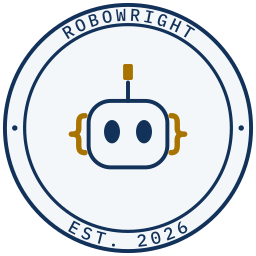
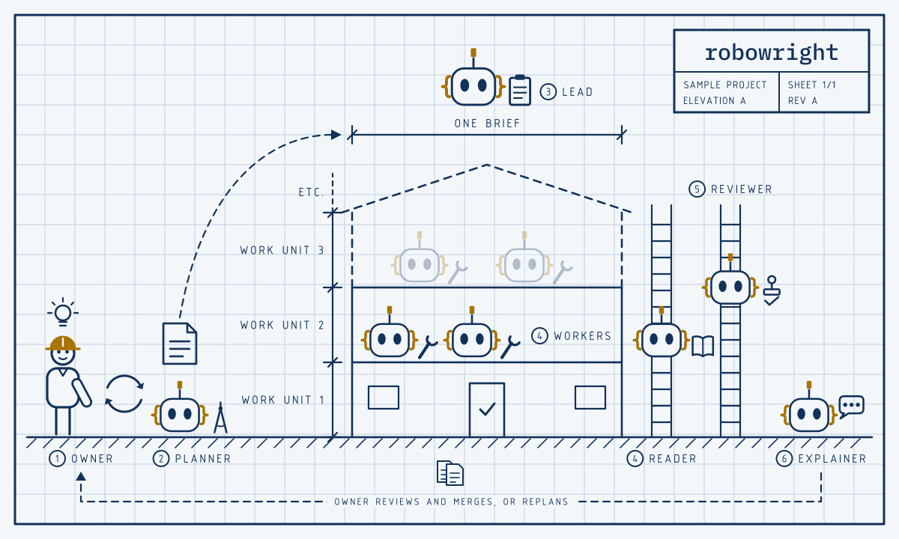
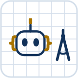
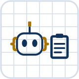
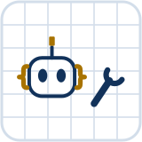
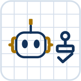
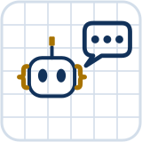
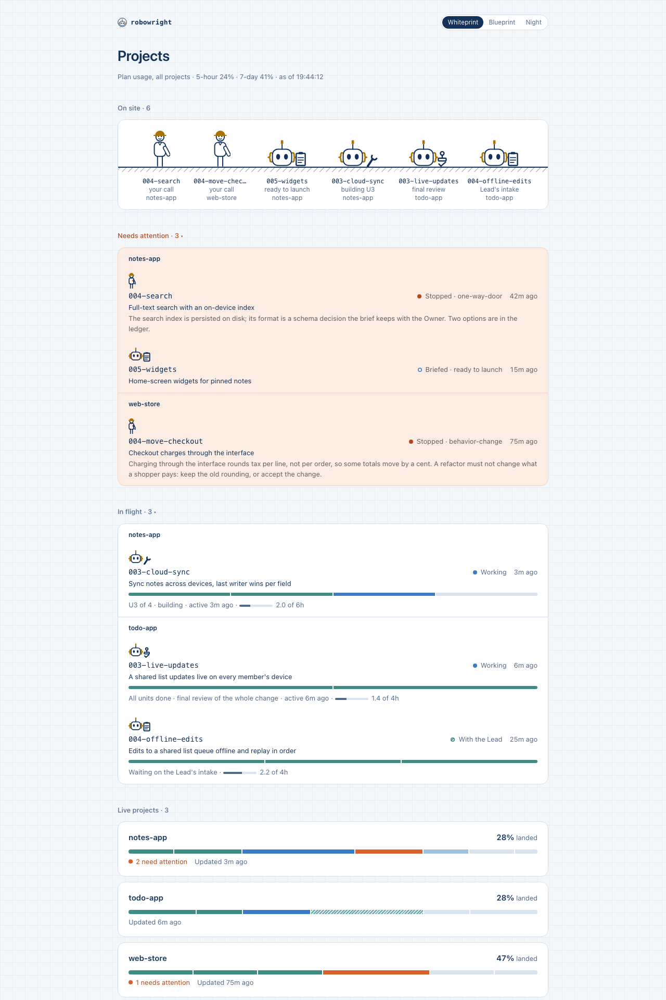
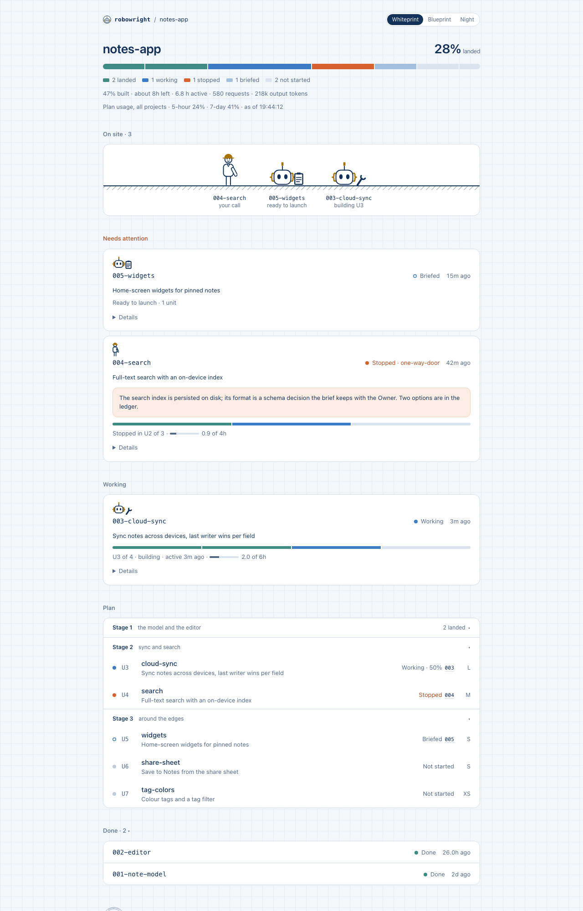

<p align="center">
  <picture>
    <source media="(prefers-color-scheme: dark)" srcset="assets/logo-dark.svg">
    
  </picture>
</p>

<p align="center"><b>Hand Claude Code a whole stack of changes. Come back to finished, reviewed work.</b></p>

<picture>
  <source media="(prefers-color-scheme: dark)" srcset="assets/hero-dark.svg">
  
</picture>

<details>
<summary>What the picture shows</summary>

A blueprint, left to right. The Owner, a person in a hard hat with a light bulb overhead, and the Planner robot go back and forth, shown as a cycle of two arrows, and a sheet goes from the Planner to a three-storey building marked one brief, with the Lead robot above it. Each floor is a work unit: the first has a check mark in its front door, two Worker robots build the second, the third is still dashed, and the chain of units runs on to etc. The Reader robot is on a ladder level with the Workers, and the Reviewer robot is on a second ladder, at the line between the second and third floors. Along the bottom, a line labelled owner reviews and merges, or replans, runs from the Explainer robot on the right back to the Owner, under two record sheets.

</details>

To run a project, start from [`MANUAL.md`](MANUAL.md); anything it does not cover is asked with `/robowright help <your question>`.

Robowright turns Claude Code into a small crew. You agree a plan with one session, and the
rest runs without you: each change is built in its own git worktree, gated by a reviewer that
never saw it being written, and published however your project hook says. Accepting it stays yours.
Every hand-off is a file on disk, so any session can die and a fresh one picks up where it
stopped.

It's beta. These are the workflows I kept reaching for on my own projects, with the repetitive
parts written down once as skills and agents. The habits are current practice: tests written
before the code (`bdd`), every new test proven able to fail (`load-bearing-tests`), every doc
it hands you fact-checked by a fresh reader (`doc-gate`), and a smoke pass written up for you
(`smoke-test`). It's built to keep context small, too: a fresh session per unit by default, and
logs read by a Haiku subagent that hands back only the verdict lines.
`skills/worker/scripts/run-cost.py` counts each session's requests and tokens from its
transcript, so you can see where the usage went.

It's for one engineer who already works in Claude Code. It isn't a hosted service, a team
tool, or a CI system.

## The crew

The roles are a building crew, numbered as in the drawing above. The five-minute tour is
`skills/robowright/README.md`; the as-built map is `skills/robowright/ARCHITECTURE.md`.

| | Role |
|---|---|
| | **① Owner**, the client: you. You approve the plan, answer what only a person should, and accept the work. |
| <picture><source media="(prefers-color-scheme: dark)" srcset="assets/roles/planner-dark.svg"></picture> | **② Planner**, the architect: scopes the project with you and draws each brief, the contract a session builds to. |
| <picture><source media="(prefers-color-scheme: dark)" srcset="assets/roles/lead-dark.svg"></picture> | **③ Lead**, the superintendent: watches every session from disk and calls you only when a call is yours. |
| <picture><source media="(prefers-color-scheme: dark)" srcset="assets/roles/worker-dark.svg"></picture> | **④ Worker**, the crew: builds the brief unit by unit in its own worktree, for hours, with nobody watching. |
| <picture><source media="(prefers-color-scheme: dark)" srcset="assets/roles/reader-dark.svg"></picture> | **④ Reader**, the runner: reads one big log or tree and fetches back one fact. |
| <picture><source media="(prefers-color-scheme: dark)" srcset="assets/roles/reviewer-dark.svg"></picture> | **⑤ Reviewer**, the inspector: signs off every unit and the whole stack from a fresh context. |
| <picture><source media="(prefers-color-scheme: dark)" srcset="assets/roles/explainer-dark.svg"></picture> | **⑥ Explainer**, the handover: writes the brief you read before you review what got built. |

## The dashboard

`python3 tools/robowright-dash.py --serve 8765` serves a read-only view of every project and
Robowright Session on `127.0.0.1`. Below, three example projects: an iOS notes app, an Android
todo app and a web store.





## Quickstart

```sh
# a folder no session is granted; see "Where to clone it"
git clone https://github.com/AJschoons/robowright.git ~/src/robowright
bash ~/src/robowright/install.sh
mkdir -p ~/src/onboard && cd ~/src/onboard    # start it here, never in the clone, ~ or ~/.claude; see "Where to clone it"
claude    # then, inside the session: /robowright-onboard
bash ~/src/robowright/tests/run.sh    # the last line is EXIT=0
```

`install.sh` links every skill and agent into `~/.claude`, and writes `rw-git` into `~/.local/bin` as a small
wrapper file.
`/robowright-onboard` checks the
install, interviews you, writes your machine profile, `launch.json` and a first project hook,
links four entry points into `~/.local/bin`, and ends on the same green run.

It also offers to create the scrub gate's pattern list, empty, at
`${ROBOWRIGHT_DENYLIST:-~/.config/robowright/denylist}`: your own names that must never enter a
commit from this machine. The maintainer's patterns are never in it.

### Where to clone it

Clone it into a folder no Claude Code session is granted. The launcher, the hooks and `rw-git` run as you, outside
the sandbox, from this clone: a session that can write it can change what they do. To work on Robowright itself,
use a second clone. `SECURITY.md` → The recommended setup has the rest, step by step:

- keep your repositories under one root folder, grant no folder in your user settings, since a folder granted there
  reaches every session the launcher starts, and start your own Desktop sessions in the root instead;
- put leaf denies on `**/.git`, `**/.claude` and `**/.mcp.json`, and a deny on the folder you install from, in the
  root's `.claude/settings.json`, a link into that folder; a session started in the root then writes git only
  through `rw-git`;
- name the root in `launch.json`'s `desktop_roots`, and put `rw-git *` in `sandbox.excludedCommands` and
  `Bash(rw-git *)` in `permissions.allow`;
- run `git config --global safe.bareRepository explicit` and `git config --global core.fsmonitor false`;
- deny `~/.local/bin`, `~/Library/LaunchAgents`, `~/.ssh` and `~/.config/git` in your user settings, and never start
  a session in your home folder, since a session started there is granted it whole;
- the cost: a session started in a project folder or a repository gets none of the root's denies (measured with
  `claude -p`; Desktop sessions below the root are unmeasured);
- the limit: code an agent writes that you later build or run runs as you.

## Requirements

- macOS. It has only run on macOS; nothing here claims Linux, and there is no CI.
- `python3`, `bash`, `git` and `jq` on `PATH`.
- Claude Code, with a Claude subscription (budgeted in plan usage) or an API key (budgeted in
  dollars). The two examples under `examples/` show one of each.

## Layout

| Path | What | Linked into `~/.claude` |
|---|---|---|
| `skills/` | The role handbooks (`robowright`, `planner`, `lead`, `worker`, `explainer`), the onboarding and review-overlay skills, `one-off` (plan a one-unit ask in your own console and build it with no Lead), the companion skills, and the scripts with their suites | Yes |
| `agents/` | The Reviewer, Reader and spec-writer subagents | Yes |
| `examples/` | Two example machine profiles: `laptop` (a subscription) and `desktop` (an API key) | No |
| `tests/` | `run.sh`, which runs every suite and the whole-tree scrub check, and the suites that do not sit beside a script | No |
| `tools/` | The scrub gate and the git hooks that run it, and `robowright-dash.py`, the read-only dashboard, run from the clone | No |
| `assets/` | The logo, the hero, the role glyphs and the dashboard screenshots this page shows | No |
| `MANUAL.md` | The operating manual: the commands for running a project, task by task | No |
| `.claude/robowright/project.md` | This repository's own project hook | No |

`install.sh` links only `skills/` and `agents/`, and writes the `rw-git` wrapper into `~/.local/bin`.

## Support

Best effort: issues and pull requests are read, with no promise of when. `CONTRIBUTING.md` says
what a change needs; `SECURITY.md` says what an unattended session can do and how to report a
vulnerability.

## License

MIT; see `LICENSE`.
