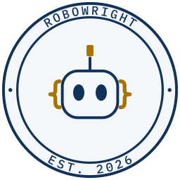
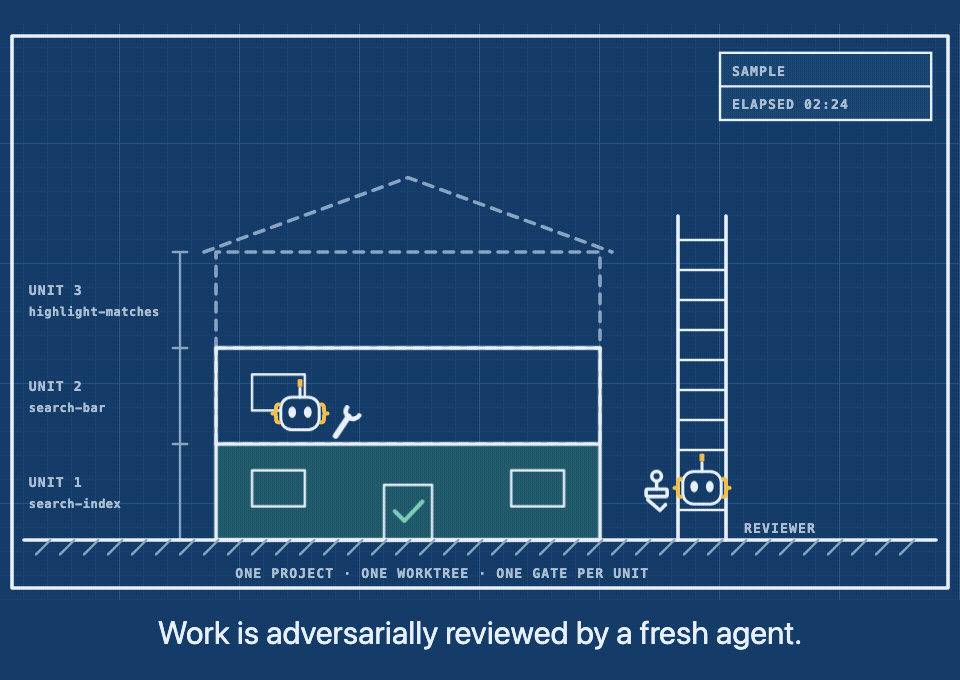
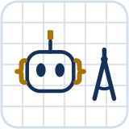
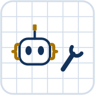
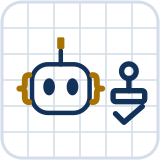
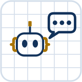
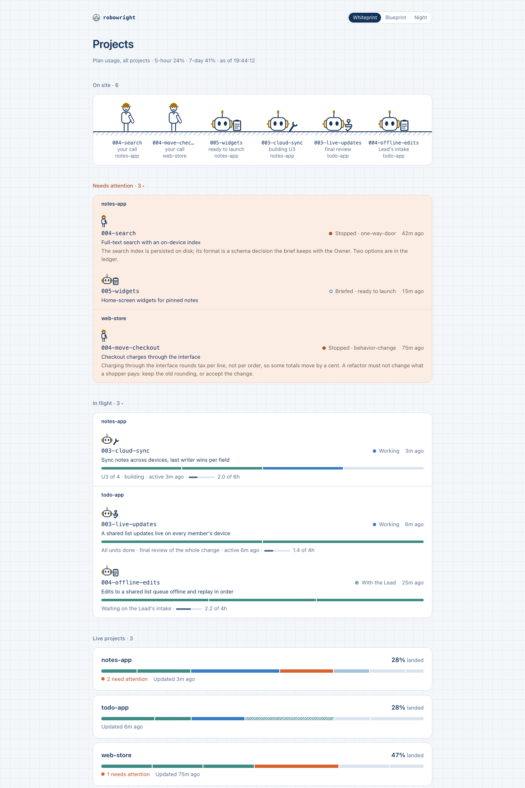
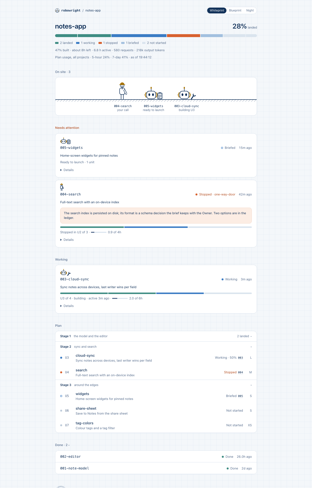

<p align="center">
  <picture>
    <source media="(prefers-color-scheme: dark)" srcset="assets/logo-dark.svg">
    
  </picture>
</p>

<p align="center"><b>Hand Claude Code a whole stack of changes. Come back to finished, reviewed work.</b></p>

<a href="https://robowright.dev"></a>

<details>
<summary>What the animation shows</summary>

The inspection from robowright.dev. A Worker is building unit 2 of a three-unit project. Before the unit can close, a Reviewer that never saw it being written climbs up to inspect it and holds it with a finding. One fix, then a fresh inspection, and the unit is signed off with the finding on file. The full story is at robowright.dev.

</details>

To run a project, start from [`MANUAL.md`](MANUAL.md); anything it does not cover is asked with
`/robowright help <your question>`.
Robowright is thorough rather than fast: you plan once with it, then check back in hours, not
minutes.

## Quickstart

```sh
# a folder no session is granted; see "Where to clone it"
git clone https://github.com/AJschoons/robowright.git ~/src/robowright
bash ~/src/robowright/install.sh
mkdir -p ~/src/onboard && cd ~/src/onboard    # start it here, never in the clone, ~ or ~/.claude; see "Where to clone it"
claude    # then, inside the session: /robowright-onboard
```

`install.sh` links every skill and agent into `~/.claude`, and writes `rw-git` into `~/.local/bin`
as a small wrapper file.
`/robowright-onboard` checks the install, interviews you, writes your machine profile, `launch.json`
and a first project hook, links four entry points into `~/.local/bin`, and ends on a green
`tests/run.sh`.
It also offers to create the scrub gate's pattern list, empty, at
`${ROBOWRIGHT_DENYLIST:-~/.config/robowright/denylist}`: your own names that must never enter a
commit from this machine.
The maintainer's patterns are never in it.

### Where to clone it

Clone it into a folder no Claude Code session is granted. The launcher, the hooks and `rw-git` run as you, outside
the sandbox, from this clone: a session that can write it can change what they do. To work on Robowright itself,
use a second clone. `SECURITY.md` → The recommended setup has the rest, step by step.

<details>
<summary>The recommended setup, in short</summary>

- Keep your repositories under one root folder, grant no folder in your user settings, since a folder granted there
  reaches every session the launcher starts, and start your own Desktop sessions in the root instead.
- Put leaf denies on `**/.git`, `**/.claude` and `**/.mcp.json`, and a deny on the folder you install from, in the
  root's `.claude/settings.json`, a link into that folder; a session started in the root then writes git only
  through `rw-git`.
- Name the root in `launch.json`'s `desktop_roots`, and put `rw-git *` in `sandbox.excludedCommands` and
  `Bash(rw-git *)` in `permissions.allow`.
- Run `git config --global safe.bareRepository explicit` and `git config --global core.fsmonitor false`.
- Deny `~/.local/bin`, `~/Library/LaunchAgents`, `~/.ssh` and `~/.config/git` in your user settings, and never start
  a session in your home folder, since a session started there is granted it whole.
- The cost: a session started in a project folder or a repository gets none of the root's denies (measured with
  `claude -p`; Desktop sessions below the root are unmeasured).
- The limit: code an agent writes that you later build or run runs as you.

</details>

## Your first run

A command that starts with `/` is a Claude Code skill, typed into a Claude Code session;
`role-start`, `run-launch.sh` and the dashboard are shell commands, typed into a terminal.
That session can run in a terminal or in the Desktop app's Code tab, so `/one-off`,
`/loop /lead watch` and `/robowright help` work in either. `role-start` stays a terminal command,
and a Desktop session does not replace it: it starts the role at the model and effort your
`robowright.json` and `launch.json` set, where a Desktop session runs on the app's own model picker.

```sh
claude --permission-mode plan    # in a terminal, in a project folder; never in the clone, ~ or ~/.claude
/one-off <ask>                   # inside that session
```

This is for one to three hours of work: you plan it in your own console, one Worker builds it with
no Lead, and you accept it.
Depth: [`MANUAL.md` → A small piece of work](MANUAL.md#a-small-piece-of-work).

## Your first big job

```
# in a terminal
role-start planner
# inside the session it opened
Run the `planner` skill from scratch for project `<project>`. Inputs: time box = `<X weeks or none>`, designs = `<link or N/A>`, prior discussion = `<links or N/A>`, related tracker items = `<comma list or N/A>`, related docs = `<paths/links or N/A>`. Start with Phase 1; ask me for anything missing before proceeding.
# in a terminal, once the plan and the first brief exist
role-start lead <project>
# inside the session it opened
/loop /lead watch    # only if your launch.json sends the Lead no first prompt
```

The Planner plans the project with you and ends when the plan and the first brief exist.
The Lead then launches each Robowright Session, watches it from disk and calls you only for what
is yours.
Depth: [`MANUAL.md` → Plan a project](MANUAL.md#plan-a-project) and
[→ Start it](MANUAL.md#start-it).

Robowright turns Claude Code into a small crew. You thoroughly plan with one session, and the
rest runs without you: each change is built in its own git worktree, gated by a reviewer that
never saw it being written, and published however your project hook says. Accepting it stays yours.
Every hand-off is a file on disk, so any session can die and a fresh one picks up where it
stopped.

It's beta. These are the workflows I kept reaching for on my own projects, with the repetitive
parts written down once as skills and agents. The habits are current practice: tests written
before the code (`bdd`), every new test proven able to fail (`load-bearing-tests`), every doc
it hands you fact-checked by a fresh reader (`doc-gate`), and a smoke pass written up for you
(`smoke-test`). It's built to keep context small, too: a fresh session per unit by default, and
logs read by a Haiku subagent that hands back only the verdict lines.
`skills/worker/scripts/run-cost.py` counts each session's requests and tokens from its
transcript, so you can see where the usage went.

It's for one engineer who already works in Claude Code. It isn't a hosted service, a team
tool, or a CI system.

## The crew

The roles are a building crew. The five-minute tour is
`skills/robowright/README.md`; the as-built map is `skills/robowright/ARCHITECTURE.md`.
The run profile that picks a Worker's model is in [`MANUAL.md` → The levers](MANUAL.md#the-levers).

| | Role | Model |
|---|---|---|
| | **① Owner**, the client: you. You approve the plan, answer what only a person should, and accept the work. | — |
| <picture><source media="(prefers-color-scheme: dark)" srcset="assets/roles/planner-dark.svg"></picture> | **② Planner**, the architect: scopes the project with you and draws each brief, the contract a session builds to. | Fable |
| <picture><source media="(prefers-color-scheme: dark)" srcset="assets/roles/lead-dark.svg"></picture> | **③ Lead**, the superintendent: watches every session from disk and calls you only when a call is yours. | Opus |
| <picture><source media="(prefers-color-scheme: dark)" srcset="assets/roles/worker-dark.svg"></picture> | **④ Worker**, the crew: builds the brief unit by unit in its own worktree, for hours, with nobody watching. | Opus, or Sonnet by run profile |
| <picture><source media="(prefers-color-scheme: dark)" srcset="assets/roles/reader-dark.svg"></picture> | **④ Reader**, the runner: reads one big log or tree and fetches back one fact. | Haiku |
| <picture><source media="(prefers-color-scheme: dark)" srcset="assets/roles/reviewer-dark.svg"></picture> | **⑤ Reviewer**, the inspector: signs off every unit and the whole stack from a fresh context. | Opus for code, Sonnet for prose |
| <picture><source media="(prefers-color-scheme: dark)" srcset="assets/roles/explainer-dark.svg"></picture> | **⑥ Explainer**, the handover: writes the brief you read before you review what got built. | Opus |

## The dashboard

`python3 ~/src/robowright/tools/robowright-dash.py --serve 8765` serves a read-only view of every
project and Robowright Session on `127.0.0.1`, or a session can start it for you.
Below, three example projects: an iOS notes app, an Android todo app and a web store.





## Requirements

- macOS. It has only run on macOS; nothing here claims Linux, and there is no CI.
- `python3`, `bash`, `git` and `jq` on `PATH`.
- Claude Code, with a Claude subscription (budgeted in plan usage) or an API key (budgeted in
  dollars). The two examples under `examples/` show one of each.
- Several things stop a run nobody is watching before it finishes, among them: the brief's
  wall-hours allowance; on an API key, a dollar cap in each brief; on a subscription, `usage-guard`
  writing `STOP` into every running or resumable session at a plan-usage threshold; and a `STOP`
  file you create in the session's folder.
  See [`MANUAL.md` → Spend](MANUAL.md#spend).
- The skills and agents are Markdown files Claude Code loads; the launcher, `run-launch.sh` and
  `role-start`, is what builds the `claude` command that starts each session.

## Layout

| Path | What | Linked into `~/.claude` |
|---|---|---|
| `skills/` | The role handbooks (`robowright`, `planner`, `lead`, `worker`, `explainer`), the onboarding and review-overlay skills, `one-off` (plan a one-unit ask in your own console and build it with no Lead), the companion skills, and the scripts with their suites | Yes |
| `agents/` | The Reviewer, Reader and spec-writer subagents | Yes |
| `examples/` | Two example machine profiles: `laptop` (a subscription) and `desktop` (an API key) | No |
| `tests/` | `run.sh`, which runs every suite and the whole-tree scrub check, and the suites that do not sit beside a script | No |
| `tools/` | The scrub gate and the git hooks that run it, and `robowright-dash.py`, the read-only dashboard, run from the clone | No |
| `assets/` | The logo, the inspection loop, the role glyphs and the dashboard screenshots this page shows, and the hero drawing the site shares | No |
| `MANUAL.md` | The operating manual: the commands for running a project, task by task | No |
| `.claude/robowright/project.md` | This repository's own project hook | No |

## Support

Best effort: issues and pull requests are read, with no promise of when. `CONTRIBUTING.md` says
what a change needs; `SECURITY.md` says what an unattended session can do and how to report a
vulnerability.

## License

MIT; see `LICENSE`.
