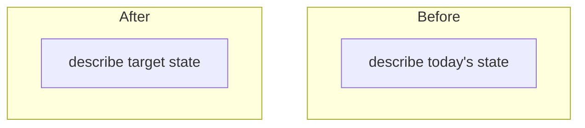
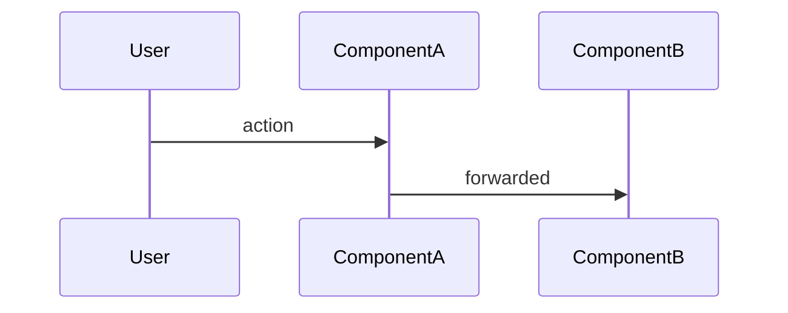

# [Project name] — project plan

**Project:** [project name]
**Tracker:** [parent item link and title, in the form the project hook's **Naming** section defines] *[remove if the machine has no tracker]*
**Post-rollout cleanup item:** [link and title] *[remove if no flag / no cleanup phase]*
**Counterpart work on another client:** [link and title] *[remove if single-client]*
**Designs:** [title and link]
**Feature flag:** `[flag-key]` ([flag type]) *[remove if the change does not ship behind a flag]*
**Related tech-debt (resolved as side effect):** [link and title]
**Related rearchitecture context:** [link to ARCHITECTURE.md] *[remove if N/A]*

> Sizes and complexity in this document are deliberately relative — translating to calendar days requires deeper planning than this workflow covers.

Paths below are relative to the roots the machine profile's **Paths** section names; `<project>/` is this folder.

## For Future Agents

**Prompt 1 (onboarding) — copy and paste this to get a new agent up to speed:**

> Read all files in `<project>/` starting with `PROJECT.md`. PROJECT.md is the main plan and has all context, decisions, architecture, key files, and gotchas. Then look in the `Agent Explorations/` subfolder for per-unit investigation reports — each unit has a thorough exploration doc with implementation steps, risks, and code citations. Check the **Status & Progress** section in PROJECT.md for what's already been completed and any deviations from the original plan. After reading, confirm what you understand. Then look at the **Task Breakdown** table, identify the next incomplete unit, and suggest it — but ask me to confirm before planning.

**Prompt 2 (unit planning) — use after the unit is confirmed:**

> Pull in any relevant context for the confirmed unit (the corresponding `Agent Explorations/<unit>.md` doc, the tracker item if there is one, related codebase files). Then create an incremental step-by-step implementation plan where each step is a reviewable and committable unit. Follow the **Workflow** section in PROJECT.md for execution rules.

---

## Robowright

Settings for the Robowright on this project, decided at kickoff and kept in `robowright.json` beside
this file (the file is the authority; this table is for readers).

| | | Why |
|---|---|---|
| Delegation | `planner` — Lead decides reversible execution calls, Planner rebriefs and reviews; the Owner-only floor is the profile's | |
| Planner review at `finish` (`plan_review`: `finish`, `per-unit` or `off`) · owner brief per stack · project report | `finish` · on · on | |
| Planner · Lead · Worker · Explainer | `fable` · `opus` · `opus` · `opus` | |
| Reviewer code · prose · Reader | `opus` · `sonnet` · `haiku` | |

---

## Workflow

Rules for how implementation plans should be structured and executed on this project.

### Planning

- **Read the corresponding `Agent Explorations/<unit>.md` doc first** — each unit has a thorough exploration with files, code references, implementation steps, risks, and size + complexity. Use it as the starting point for the plan.
- **Read the tracker item** for the unit being planned, where there is one — use it as the source of acceptance criteria alongside this PROJECT.md and the exploration doc. If the item and PROJECT.md diverge, flag the discrepancy.
- **Read relevant codebase files** before finalizing the plan — understand existing patterns so the plan references concrete types, methods, and file paths.
- **Structure the plan as numbered steps** where each step is a single reviewable and committable unit. Steps should build on each other logically.
- **Front-load design decisions** that need input — surface them during planning so they're resolved before implementation starts, not mid-step.

### Execution

- **Branch name:** the format the project hook's **Naming** section defines, based on its `<base_ref>`. Create the branch BEFORE the first commit. Whether an unmerged predecessor's branch is a valid base, and when to prefer it, is per the project hook → **Publishing**.
- **Execute one step at a time.** After completing each step, STOP and present the result for review and feedback before moving to the next step. Do not batch or chain steps.
- **Wait for explicit go-ahead** ("next", "continue", "do step N", or feedback) before proceeding.
- **Incorporate feedback immediately** — if a step needs adjustment, update the plan and re-execute that step before moving on.
- **Commit-friendly steps** — each step should leave the codebase in a compilable state so it can be committed independently. This naturally produces a change that's easy to review commit-by-commit.

### After completion

- **Update project documents** — update PROJECT.md (status, deviations, unit table) and the corresponding `<unit>.md` exploration doc (note any deviations from the planned approach).
- **Write the change description** — save it as `<project>/prs/<unit>.md`, in the form the project hook's **Publishing** section defines, so formatting survives copy-paste.
- **Identify the next unit** from the task breakdown table and note it in the status section.

---

## Status & Progress

**Last updated:** [date]

**Current status:** [one-paragraph status — which units are done, in review, in progress, next up. Note any scope changes or deviations.]

**Approach decision:** [one-sentence summary of the chosen approach — see Approach Decision section below for full context]

**Deviations from original plan:**
- [Bullet per deviation — what changed, why, what doc was updated]

---

## Task Breakdown

> Sizes and complexity are deliberately relative — translating to calendar days requires deeper planning than this workflow covers.
>
> The `Unit` cell is the unit id: `run.json.ticket`, or the session directory's name where there is none. That is the slug, or the tracker key on an install whose `launch.json` sets `unit.ticket_regex`.
>
> The Planner fills `Summary` when the row is created — one or two plain sentences on what the chunk does, never its status — and the dashboard shows it as the unit's purpose line, falling back to `Description` when it is empty.

| # | Unit | Summary | Tracker | Description | Exploration Doc | Size | Complexity | Status |
|---|------|---------|---------|-------------|-----------------|------|------------|--------|
| U0 | `<unit>` | [One or two sentences: what this chunk does] | [link] | [Description] | (flag scaffolding) | XS | Low | [Done / In Progress / In Review / Not Started] |
| U1 | `<unit>` | [One or two sentences: what this chunk does] | [link] | [Description] | [`<unit>.md`](./Agent%20Explorations/<unit>.md) | S | Low | [status] |
| U2 | `<unit>` | [One or two sentences: what this chunk does] | [link] | [Description] | [`<unit>.md`](./Agent%20Explorations/<unit>.md) | M | Medium | [status] |
| U3 | `<unit>` | [One or two sentences: what this chunk does] | [link] | [Description] | [`<unit>.md`](./Agent%20Explorations/<unit>.md) | L | High | [status] |
| UN | `<unit>` | [One or two sentences: what this chunk does] | [link] | [Description] | [`<unit>.md`](./Agent%20Explorations/<unit>.md) | M | Medium | [status] |
| Design + QA | `<unit>` | Design + QA polish and bugs surfaced in review. | [link] | Design + QA feedback (placeholder — tracks polish/bugs surfaced in review) | (placeholder) | S | Low | Not started |
| Cleanup | `<unit>` | Removes the flag and the legacy paths after rollout. | [link] | [Post-rollout cleanup — flag removal, dead-code deletes, delegate rewire] | (cleanup of flag + legacy paths) | L | Medium | Not started — post-launch |

---

## Detailed TODO

Each unit's detailed steps live in the corresponding `Agent Explorations/<unit>.md` file. The exploration docs are the source of truth for implementation-level detail. Below is the sequencing summary: one `### Stage N — <theme>` heading per stage, its units in order, each as `U<n> (<name>)` (`robowright` → Contracts every role keeps, 11).

### Stage 1 — Foundation (no user-visible change)

1. **U0 (<name>)** — [description]. [size/complexity. No user-visible change.]
2. **U1 (<name>)** — [description].

### Stage 2 — [theme]

3. **U2 (<name>)** — [description].
4. **U3 (<name>)** — [description].

### Stage 3 — [theme]

5. **U4 (<name>)** — [description].

### Stage N — Polish

- **Design + QA feedback** — placeholder; runs once the feature is testable end-to-end. Scope firms up as feedback lands.

### Post-rollout (after the flag goes 100%) *[remove if the change does not ship behind a flag]*

N. **Cleanup unit** — flag removal, legacy path deletion, deferred constant cleanup. Absorbs any units that were deferred during the flag-gated phase.

---

## Cadence *[remove if the project has no time box]*

- **Week 1 (days 1-5):** [units accepted this week].
- **Week 2 (days 6-10):** [units accepted this week].
- **Week 3 (days 11-15):** [units accepted this week + manual matrix + buffer]. *[remove if 1-2 week project]*

---

## Known Issues / Deliberate Scope Cuts

These are accepted trade-offs to fit the project. Each may need a follow-up. Surface to whoever owns the call before launch.

1. **[Scope cut name].** [What's lost, why it's accepted, follow-up filed if any.]
2. **[Scope cut name].** [What's lost, why it's accepted.]

---

## Deferred Polish (time allowing)

Visual / structural improvements that are out of the in-flight units' scope but worth picking up at the end of the project before launch if there's time. Not blockers — current implementation is acceptable.

> Sizes are deliberately relative — translating to calendar days requires deeper planning than this workflow covers.

1. **[Polish item name].** [Description of what's wrong today + desired behavior + why it's worth doing.]
   - **Desired behavior:** [...]
   - **Implementation sketch:** [...]
   - **Flag gate:** [flag-on only / cross-flag / N/A]
   - **Related:** [Known Issues #N or other cross-reference]
   - **Open questions:** [if any]
   - **Size:** [XS/S/M/L/XL] · **Complexity:** [Low/Medium/High/Very High]

2. **[Polish item name].** [...]

---

## What We're Building

[2-3 paragraph plain-language description of the project — what users see, what changes structurally, what stays the same.]

[Diagram or bulleted breakdown of major changes if needed.]

### Scope Constraints

- **Single flag rollout** — no experiment, no A/B test. *[adjust to project]*
- **One client only** — the other clients are parallel projects not coordinated through this doc. *[adjust to project]*
- **[Other constraints]**

## Language

The glossary terms and leading words this plan uses, each defined in a line. Exploration docs and briefs copy from here; the glossary itself lives where `domain-modeling` keeps it.

| Term | Means | Avoid |
|---|---|---|
| [term] | [one or two sentences: what it is] | [the words it replaces] |

Grounding reports: `GROUNDING.md` in this folder.

---

## Approach Decision: [chosen approach name]

The team considered [N] approaches before landing on the current design:

### Approach A — [name] (rejected)

[Description.] **Rejected** because:
- [Reason 1]
- [Reason 2]

### Approach B — [name] (rejected)

[Description.] **Rejected** because:
- [Reason 1]
- [Reason 2]

### Approach C — [name] (selected)

[Description.] **Selected** because:
- [Reason 1]
- [Reason 2]
- [Reason 3]

The path forward is Approach C. A and B are documented for posterity in case future revisits are needed.

---

## Key Files

### Production code (changes expected)

| Purpose | Path |
|---------|------|
| [What] | `[path]` |
| [What] | `[path]` |

### Infrastructure (changes for U[N])

| Purpose | Path |
|---------|------|
| [What] | `[path]` |

### Feature flag *[remove if N/A]*

| Purpose | Path |
|---------|------|
| Flag registration | `[path]` |
| Flag registry | `[path]` |

### Tests (mocks may need updates)

| Purpose | Path |
|---------|------|
| [What] | `[path]` |

### Architecture / docs to update

| Purpose | Path |
|---------|------|
| Architecture overview | `[path]` |
| Feature README | `[path]` |
| Always-on rule for this area | `[path]` |

---

## Architecture

### [Before vs. after diagram]



### [Key transition diagram, if applicable]

```mermaid
flowchart LR
    [transition description]
```

### [Key sequence diagram, if applicable]



---

## Gotchas and Important Notes

### [Gotcha topic 1]

[Specifics — what's surprising, why it's wired this way, what to watch for.]

### [Gotcha topic 2]

[Specifics.]

### [Topic deferred or blocked on something]

[Why it's deferred, what unblocks it.]

---

## Resolved Decisions

Dated and attributed, newest last. Attribution tells the next reader who to go back to; the date tells them whether anything after it might have superseded it. Add a row every time a re-sync turns something up (standing principle 3), and link the source where it isn't obvious.

| Date | Decision | Who | Source |
|------|----------|-----|--------|
| [M/D] | [Decision + resolution] | [Name(s)] | [where it was decided] |
| [M/D] | [Decision + resolution] | [Name(s)] | [link] |

**Rationale for the non-obvious ones:**

- **[Decision name].** [Why this way, what was given up, what would make us revisit.]

---

## Open Questions

### [Topic group 1]

- **[Question].** [Resolved / Still open.] [Resolution if resolved.]
- **[Question].** [Status.]

### [Topic group 2 — form factors / accessibility / cross-client]

- **[Question].** [Status.]

### Scope cuts to ratify before launch

- **[Item].** Accept or block?

---

## Related Documents

### Inside this folder

- [`Agent Explorations/<unit>.md`](./Agent%20Explorations/<unit>.md)
- [`DECISIONS.md`](./DECISIONS.md)
- [`POST-SWEEP-CLEANUP.md`](./POST-SWEEP-CLEANUP.md) *[if a cleanup phase produced one]*

### In the workspace

- [`[architecture doc path]`] — architecture overview
- [`[readme path]`] — feature README
- [`[always-on rule path]`] — coding constraints for this area
- the original scratch plan, in the inbox the profile's **Paths** section names

### External

- [Design links]
- [Other external references]

---

This document is the single source of truth for [project name]. If you're picking up work in a new agent session, start here. The exploration docs in `Agent Explorations/` provide implementation-level detail per unit.
