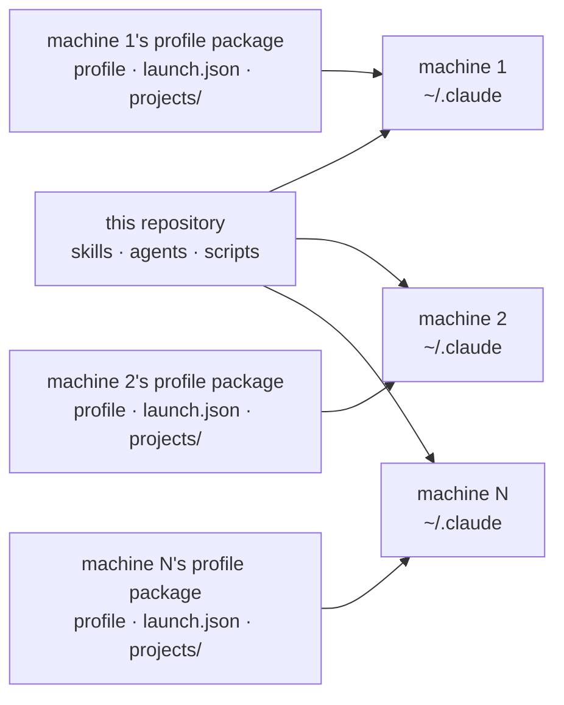
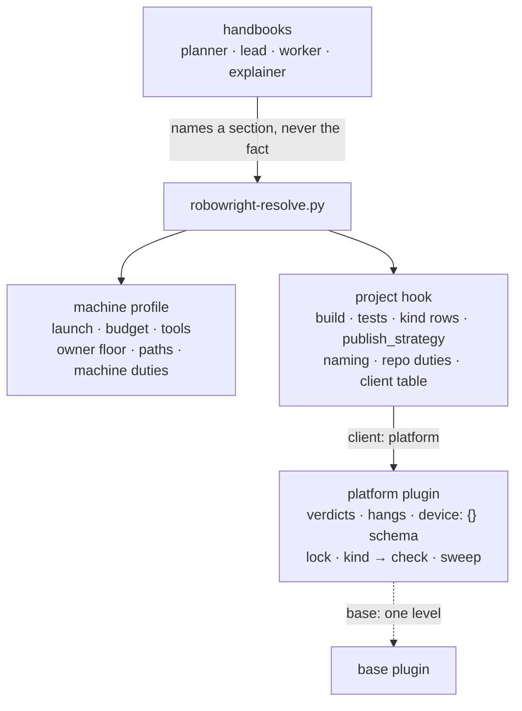
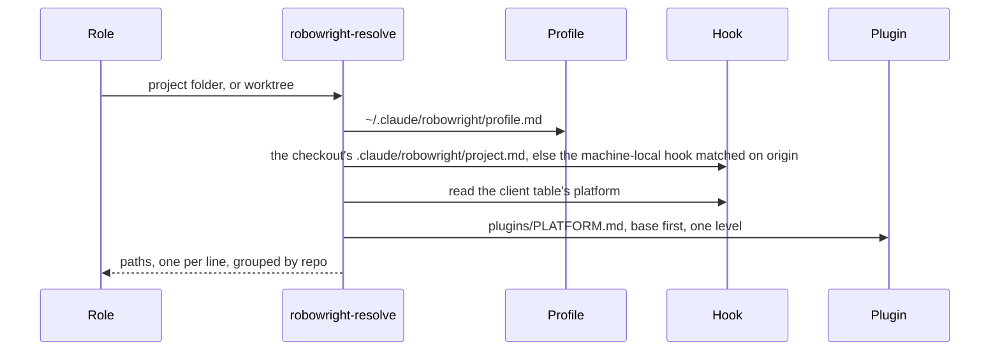
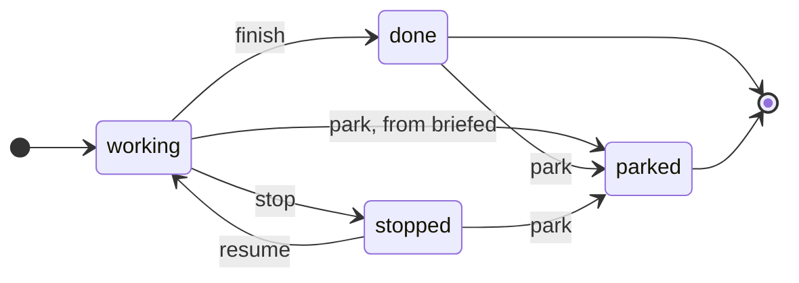
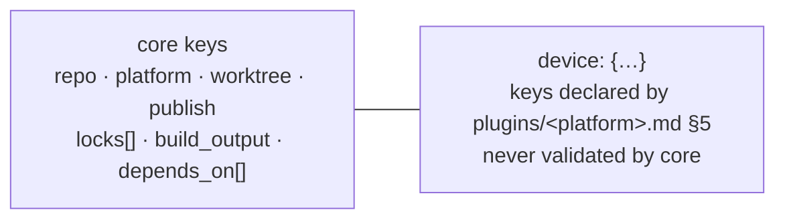
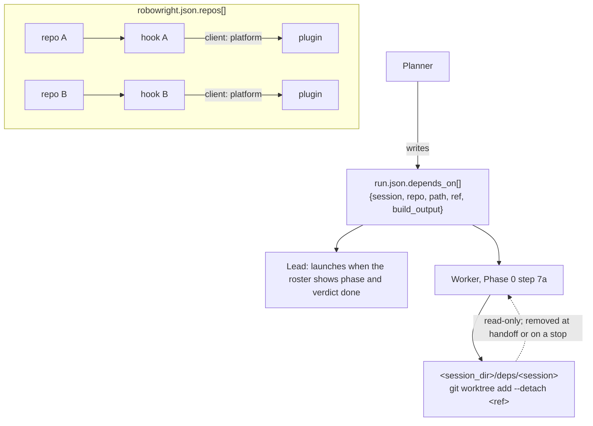

# Robowright — architecture

Where the system's files live, how they install on each machine, which layer a fact belongs to, and
how a Robowright Session moves through them. For people; no role reads this to do its work. The
roles and their contracts are in `SKILL.md`.

## 1 · One system, N installs

Every skill, agent and script lives once, in this repository; `install.sh` links it into
`~/.claude/` on every machine (§8). Machines differ in facts, never procedure: each machine adds
its own profile package, and each repository its own project hook.

| Package | Installed on | Contributes |
|---|---|---|
| This repository (the clone) | Every machine | `skills/{robowright,planner,lead,worker,explainer,…}/`, `agents/{reviewer-*,reader-roster,reader-file,worker-spec,log-reader,ui-tree-reader}.md`, the scripts under `robowright/scripts/` |
| A profile package | One machine each | `.claude/robowright/{profile.md,launch.json,projects/,plugins/}`, that machine's duty skills if any, and the `~/.local/bin` entry points (`run-launch.sh`, `role-start`, `claude-usage`, `usage-guard`) that link back into `robowright/scripts/`. `/robowright-onboard` writes the same files in place for a machine with no package of its own |

No install carries a second copy of the handbooks.



## 2 · Layers

| Layer | Carries | Resolved from |
|---|---|---|
| Handbook | What is true of the system: roles, phases, state machine, invariants | The skill tree, identical on every machine |
| Machine profile | What is true of one machine: identity, launch, budget, tools, owner floor, paths, the machine's duties | `~/.claude/robowright/profile.md`; contract in `PROFILE-CONTRACT.md` |
| Project hook | What is true of one repository: build, tests, kind-row overrides and trigger rows, device, sweep, commits, publishing and its publish strategy, traps, naming, the repository's duties | `<repo>/.claude/robowright/project.md`, else `~/.claude/robowright/projects/<name>.md` matched on `origin`; contract in `../worker/PROJECT-HOOK.md` |
| Platform plugin | What is true of one toolchain: verdict and hang shapes, the device model, `device: {}`'s schema, the lock name and liveness rule, the default kind → check table, the sweep method | `plugins/<platform>.md`, named by a hook's client table; contract in `PLUGIN-CONTRACT.md` |

A handbook that needs a machine, repository, or platform fact names the profile, hook, or plugin
section, never the fact. Which layer a new fact belongs in: `SKILL.md`, "Three layers, and where
a new fact goes".



**The boundary rule: a fact goes in the profile only if it is true of every repository on that
machine.** Publishing is hook §10, naming hook §13, and duties are listed in both files: at an
extension point a handbook runs the profile's rows, then the hook's. The one exception is
`launch.json`: it holds the unit-of-work pattern from Naming, but it is one file per machine, so
one pattern has to fit every hook on that machine.

Two resolutions cross the layers. A unit's kind checks resolve plugin default → hook override →
hook triggers: the plugin's kind → check row for the unit's kind, replaced whole by the hook's §6
row for that kind where it has one, plus every hook trigger row whose subject the diff touches,
whatever the kind (`../worker/SKILL.md` Phase 2 step 5). Publishing resolves through the hook
alone: its §10 names one publish strategy from a closed set — `draft-pr`, `local-branch`,
`push-to-branch`, `pr-plus-deploy` — and `run.json.publish` carries that name (§5).

A plugin may name a second plugin to inherit from with a `base:` identity line; that inheritance
is one level only — a base plugin carrying its own `base:` is a refusal, never a second hop. The
plugins on disk, all three bases:

| Plugin | Owns |
|---|---|
| `plugins/ios.md` | `xcodebuild` and result-bundle verdicts, the simulator and accessibility-tree device model, the `ios-build` lock, the snapshot-matrix and build-and-walk sweeps |
| `plugins/android.md` | Gradle exit-code and task-list verdicts, Paparazzi as the default environment and its ceiling, the golden-PNG sweep; no lock |
| `plugins/web.md` | A browser over a local static server as the device model, for a static site with no build step and no test runner; no lock, no `device: {}` |

## 3 · Reading chain per role

Every role starts by running `scripts/robowright-resolve.py` and reading each path it prints, in
order: the profile once, then per repo its hook, then the plugins that hook's clients name, base
plugins before the plugins that name them, a path already printed not repeated.

| Role | Runs it on | Resolves |
|---|---|---|
| Planner, Lead, Explainer | The project folder (`../planner/SKILL.md:47`, `../lead/SKILL.md:36`, `../explainer/SKILL.md:120`) | Every entry of `robowright.json.repos` — `{name, path, origin}`, `origin` checked against the checkout's remote, and optional for a checkout with its own hook — in list order |
| Worker | Its worktree (`../worker/SKILL.md:223`) | That checkout alone; it never reads `robowright.json`. Of the plugins printed it reads only the one its brief's `client` names, plus that plugin's `base:`; client `none` reads none |

A folder holding a `robowright.json` is a project folder even when it sits inside another
repository's checkout, as under a projects root kept in git; a checkout's own root always
resolves as that checkout, and a folder inside a checkout without one as the enclosing checkout.

Exit 4 is the refusal — no profile, no hook, no plugin, or a `robowright.json.repos` the resolver
cannot validate — and every role quotes the resolver's message rather than guessing a default.



## 4 · Session lifecycle

`session-state.py` is the one writer of a Robowright Session's state fields; `STATES.md` draws
every machine from `state-machine.json`, the working phases and their guards included. At one
screen, a session comes to rest in one of three phases. Only `done` and `parked` are terminal,
and the Worker never reaches `parked`:

- `stopped` — resumable, so not terminal.
- `done` — the Lead's intake takes over.
- `parked` — reached only by the Owner's `park`, from `briefed`, `done` or `stopped`. It is a
  leaf. The roster, `spend-guard.py` and the Lead all leave it alone.



`working` stands for the briefed, intake, implementing, awaiting-rotation and end-of-stack
phases, which `STATES.md` "Robowright Session lifecycle" draws with their events.

Locks are taken and released by the Worker, per the hook's Device section. The launcher only
refuses a second holder. `park` is the one piece of code that removes a lock: it removes each
lock under the sessions root (`launch.json`'s `sessions_root`) whose `owner` names the parked
session, and records the names in `run.json.parked.released`.
A resumed Worker takes its locks again, by the liveness rule in its platform plugin's §6
(`plugins/ios.md`).

The roster (`../lead/scripts/run-roster.py`) drops a terminal session's row once it has been
quiet for 48 hours, and prints every parked session on its own
`parked: <run> · <age> · <reason>` line below the table, however old. A `--since` tick prints
only what changed. A parked session's line appears when its fingerprint changes; for a parked
session, crossing 48 hours is not a change, and only removing its directory or leaving its
`run.json` unreadable prints `no longer on the roster` (`../lead/SKILL.md` "`parked` — the Owner said leave it"). A `done` or
`stopped` session that crosses 48 hours does print `no longer on the roster`
(`../lead/scripts/run-roster.py:721-743`).

The launcher can exit 0 three ways: it started a session; `launch.json` says `paste` (or has no
`launch` key), so it started nothing and handed off; or under `auto`, `claude --bg` hit EPERM and
it handed off. A hand-off prints the line the recipient pastes and appends a `hand-off via` entry to
the ledger. It records no phase in `run.json`, because the stored phase is already the one a
started session begins from (a `--rotate` or `--resume` still writes the replaced session's
cost block first). Once it has been pasted, `run-launch.sh --pin <id>` writes
`session_id` and `transcripts` as a launch would, starting nothing. It refuses, writing
nothing, a session the registry does not know and a session whose registered `cwd` is not the
worktree, symlinks followed on both sides; `--dry-run` reports the same refusal. Any other
`claude` failure exits 1.

## 5 · `run.json`, core and the plugin block

`run.json` splits the same way as the layers (`../worker/templates/run.json`). Core owns every
key but `device`. `repo` names the `robowright.json.repos` entry the session works in (§6).
`platform` names the unit's plugin, `build_output` its build folder, and `locks: []` the lock
names the plugins' §6 define — the launcher maps each to `<sessions root>/.<name>-lock` and
refuses a second holder of any of them. `mcp` lists the MCP servers the launcher gives the
session, each from the approved list at `mcp/` (`mcp/README.md`); the launcher builds the
session's MCP config and allow rules from it and refuses a server the list lacks. `publish` is
`null` (publish nothing) or the hook's strategy name, and once published a record carrying that
name as `strategy`; the Worker's Phase 3 step 7 and the Lead's post-publish duties read it.
`depends_on: []` lists `{session, repo, path, ref, build_output}` per dependency (§6); the
Planner writes it, the Worker and the Lead read it, and no script does. `device: {}` is the plugin's block: its §5 declares
the keys, and core never validates them.



**One named exception, not precedent:** `../worker/hooks/resume-context.sh:23` is the one core
reader of `device`, printing `device.udid` (else `unknown`) after a compaction. The old
spellings — `udid`, `device_lock`, `derived_data`, `verification.whole_target_runs_owed` and
`whole_target_runs`, `run_dir` and `sweep` — are no longer read: a finished session still
carries them, and nothing warns. `publish: true` is refused as `bad-publish`;
`false` and `null` publish nothing.

## 6 · Multi-repo and the dependency checkout

A project's `robowright.json.repos` lists every repository it touches, each `path` absolute or
`~/`-rooted; the resolver refuses a relative one (`scripts/robowright-resolve.py`). The Planner
names one entry per brief in `run.json.repo`, and the Lead creates the worktree from that entry's
`path`, per that repo's hook → Worktree; a `repo` that names no entry is refused
(`../lead/SKILL.md` "Launch hand-off"). A Robowright Session works in one repository.

When a unit needs a finished Robowright Session's commit from another repo, the Planner copies that
repo's `repos[].path` into the brief's `depends_on` entry. The Lead launches only once the
roster returns that session with `phase` `done` and `verdict` `done`; a `parked` session or an
`invalid:<why>` verdict blocks it (`../lead/SKILL.md:477-481`, `../planner/SKILL.md:557-565`). The
Worker's preflight (step 7a) checks the commit out read-only at `<session_dir>/deps/<session>`,
and runs again on every resume; it removes that checkout at handoff or on an early stop. A
hook's `depends_on non-empty` trigger row is the one place a check runs against a dependency's
`build_output` (`../worker/PROJECT-HOOK.md` §6).



## 7 · Which file do I edit

| I'm adding… | Edit |
|---|---|
| A new machine | `~/.claude/robowright/profile.md`, per `PROFILE-CONTRACT.md`'s seven sections; here, the profile package's `.claude/robowright/profile.md` |
| A new repository | A project hook, per `../worker/PROJECT-HOOK.md`'s fourteen sections; here, the profile package's `.claude/robowright/projects/<name>.md` |
| A new platform | `plugins/<platform>.md`, per `PLUGIN-CONTRACT.md` |
| A near-platform | `plugins/<platform>.md` with `base: <platform>` as its second identity line, one level only |
| A private platform, or one machine's variant of a shipped one | `~/.claude/robowright/plugins/<platform>.md`, which the resolver reads before the clone's `plugins/` |
| A duty | The profile's §7 Duties (every repo on that machine) or the hook's §14 Duties (one repo) |
| A second repository in a project | An entry `{name, path, origin}` in the project's `robowright.json.repos`, from `../planner/ROBOWRIGHT-TEMPLATE.json`; `origin` may be `null` when the repository has its own hook |
| A cross-repo dependency | The brief's `run.json.depends_on` entry (the Planner's), and a `depends_on non-empty` trigger row in the dependent repo's hook §6 for any check against it |
| A system-wide rule | The role's handbook |

## 8 · Install

`install.sh`, at the root of the clone, is the one install step:

```sh
bash <clone>/install.sh
```

- It creates `~/.claude/skills` and `~/.claude/agents` as real directories, then links each
  directory under `skills/` to `~/.claude/skills/<name>` and each `*.md` under `agents/` to
  `~/.claude/agents/<name>.md`, printing one `linked <path>` line per link. Every target is
  absolute and resolves inside the clone.
- Nothing from `tools/`, `tests/`, `examples/`, `.claude/` or a top-level file is linked.
- A second run prints nothing and changes nothing. A link that points into an earlier robowright
  clone (a folder holding `install.sh` and `skills/robowright/SKILL.md`), or that dangles, is
  retargeted; any other link that points outside this clone is refused, as below.
- A target path holding anything that is not a symlink, a link refused above, `~/.claude/skills`
  or `~/.claude/agents` being a symlink, or either of those existing as something other than a
  directory, is refused:
  exit 1, the path named on stderr, and no link made or changed. Every target is checked before
  the first link.
- `bash <clone>/install.sh --uninstall` removes only the links whose resolved target is inside
  the clone. It resolves a link's text through any symlink inside the clone, so a link that
  reaches outside the clone through a symlink the user added there is kept, except that a
  dangling one can still be removed: the check reads its text as written once the directory
  holding the last name in its path no longer exists. A stock clone tracks no symlink.
- `$HOME` decides the target, so `HOME=$(mktemp -d) bash install.sh` is a scratch install.

## 9 · Links out

- `SKILL.md` — the roles, their contracts, and the three-layers table.
- `README.md` — the five-minute explainer.
- `OWNERS-GUIDE.md` — the system from the Owner's seat.
- `../../MANUAL.md` — the commands for running a project, task by task.
- `STATES.md` — every state machine, drawn from `state-machine.json`.
- `DESIGN.md` — the cost measurements behind the design.
- `PROFILE-CONTRACT.md`, `PLUGIN-CONTRACT.md`, `../worker/PROJECT-HOOK.md` — the three layer
  contracts.
