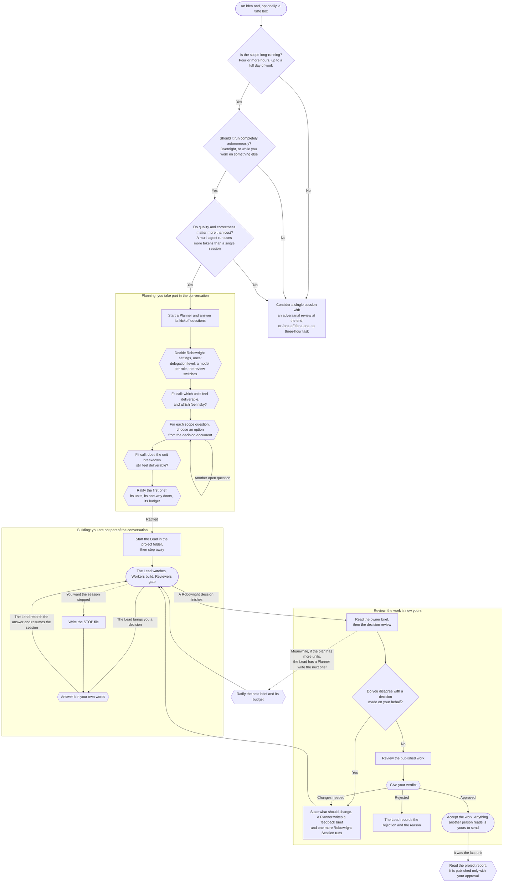
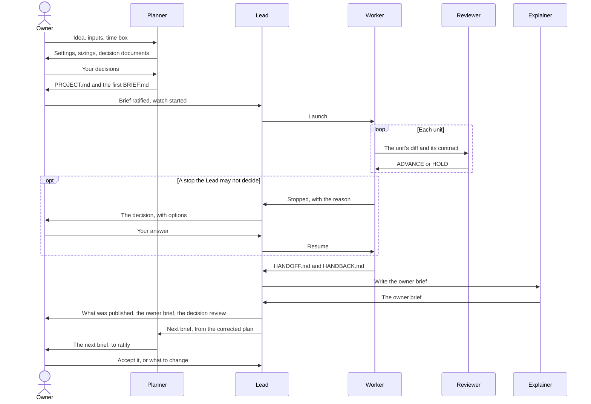

# The Owner's guide

*For the person running a project through Robowright. `README.md` describes how the system
moves. This guide describes how the Owner moves through it: what to decide, when, and what can
safely be left to the other roles. The commands for each task are in `../../MANUAL.md`.*

You are the Owner (owner). Six other roles do the work: the Planner plans, the Lead leads, the
Worker builds, the Reviewer reviews, the Reader reads, and the Explainer explains. The Owner's
part is deliberately small. You take part while the work is being **planned**, step away while
it is being **built**, and return when it is **ready for review**. In between, only the Lead
contacts you, and only about decisions that are yours.

## When to use Robowright

Robowright carries real overhead: a plan, a brief, a Lead, and a review at every gate. It
earns it when all three of these are true.

- **The scope is long-running.** Four or more hours of work, up to a full day or more.
- **The work should run completely autonomously.** Overnight, or while you work on something
  else.
- **Quality and correctness matter more than cost (token usage).** A single session generally
  uses fewer tokens; a multi-agent system can produce higher-quality results at higher usage.

If any of the three is false, consider a single session with an adversarial review at the end
instead. For a short task of one to three hours that should still be planned first and
run through Robowright, type `/one-off <ask>` in plan mode: you plan it in your own console,
and one Worker builds it on the cheaper model with no Lead.

## The Owner's path

Hexagons mark decisions only the Owner can make. Every other node is an action you take or a
stretch when you are not needed.



The next brief does not wait for your review. The Lead requests it once the finished session is
folded back into the plan, so reviewing one stack and ratifying the next brief overlap. A
project hook may narrow this (→ Publishing): where only accepted work is a valid base, a brief that
depends on the stack under review waits until you accept it.

## Decisions, in order

| When | What reaches you | What you are deciding | Where it is recorded |
|---|---|---|---|
| Kickoff | The Planner proposes the default Robowright settings | How often you are willing to be interrupted, and which model each role runs on | `robowright.json` in the project folder |
| End of Phase 1 | Every anticipated unit, sized (XS to XL) and rated for complexity | Which units you are confident in, which are risky, and which are stretch. Applies only when the project has a time box | The scope that Phase 2 negotiates |
| Each Phase 2 deep dive | A decision document: two or three options, each sized, with one recommended | The scope question itself. The Planner proposes and you decide | `PROJECT.md`, Resolved Decisions |
| End of Phase 5 | One exploration doc per unit, each sized | Whether the breakdown still feels deliverable before anything is built | `PROJECT.md`, Task Breakdown |
| End of a one-off's plan | The one unit's row, sized and rated, the model it implies, and the budget | Whether the plan is one unit, and whether the brief is the contract you want executed | `robowright.json`, then `BRIEF.md` |
| Each brief | `BRIEF.md`: units, acceptance checks, the one-way doors that stop the session, what is out of scope, and the budget | Whether this is the contract you want executed unattended, and what it may cost | `BRIEF.md` and `run.json` in the session directory |
| Mid-session, rarely | One message from the Lead: the options, what each costs downstream, and its recommendation | A decision on your floor (see below), or every stop if you chose `owner` delegation | `LEDGER.md` and `DECISIONS.md`, in your words |
| A session finishes | The owner brief and the decision review | Whether you agree with what was decided on your behalf, then whether the work is good | Accepted, rejected, or a feedback brief |
| The last unit is accepted | `REPORT.md` | Whether it is accurate, and whether anyone else should read it | Published with your approval, or not at all |

## Who holds the work

The Owner holds the work at both ends. In the middle it moves between sessions that never
contact you. Every hand-off is a file, so any of it can be read without asking anyone.

A one-off has no Lead, and a Lead running for another project leaves its rows alone
(`skills/lead/SKILL.md`, "Whose row"). At its finish the Worker has a Reviewer write `INTAKE.md`
and the Explainer write the owner brief, and a stop waits for you on the roster or the
dashboard: you answer it and resume the session yourself.



## Delegation level

The delegation level, chosen at kickoff, sets how much of a stopped session reaches you. A brief
may tighten it for a risky unit but never loosen it.

| Level | What reaches you | Suited to |
|---|---|---|
| `owner` | Every stop | The first project in a codebase, or any project whose plan you do not yet trust |
| `lead` | Your floor, plus approval of a rebrief when a session has stopped three times | Projects where execution decisions can be made for you, but a rewritten brief should be seen before it runs |
| `planner` (default) | Your floor, plus any rebrief the Planner is not confident in, and a second rebrief of the same work | Projects with a solid plan, where you want to return to finished work |

**The Owner's floor does not move, whatever the level.** It covers the budget cap or more time
than the brief allowed, shipping a behaviour change, a schema, public API or protocol change,
reversing a settled decision, anything another person reads, and whatever this machine's
profile adds under its Owner-only floor. No role makes those decisions for you, and a STOP file
you wrote is only ever answered by you.

The remaining settings are on by default and apply at every level. `owner_brief`
(`review_guide` in an older file) and `project_report` are the Explainer's documents.
`plan_review: finish` (`planner_review: true` in an older file) has a fresh Planner check the
finished stack against the plan's intent inside the session, before it finishes and before you
read it: a small polish it asks for is applied there, except at `owner` level, where it comes to
you first. `off` skips it.

## Guidance for each decision

**Ratifying a brief.** This decision carries the most leverage. At `lead` or `planner`
delegation, very little below your floor returns to you until the session is done. Check four
things: each unit is something you could review in one sitting; every acceptance check is a
command that can be run rather than a judgment; the one-way doors you care about are listed as
stops; and what is out of scope is written down. Then check the budget. The Lead proposes it
from what comparable sessions cost, and the figure you ratify is the one enforced. No role
raises it.

**Answering a decision.** The Lead brings the options, their downstream cost, and a
recommendation. It may not choose for you, and it may not pre-empt you with a "safe" option.
Answer in a sentence you would be content to read in the decision log, because it is recorded
there and attributed to you. You do not run anything yourself: the Lead records your answer and
resumes the session.

**Reading the decision review.** Everything the Lead or a Planner decided under your delegation
reaches you once, ranked by how confident the decider was, each with the condition that would
make it wrong. Overruling a decision is not a message to a session. It is a feedback brief,
because undoing the decision is work.

**Reviewing.** Read the owner brief first. It opens with what only you can decide, each with
the Planner's or the Lead's recommendation, then the decisions made for you, what changed, and
at most three lines to spot-check, each one a Reviewer held or the brief named as a hotspot. It
is capped at 1,000 words, 400 for a small unit; the rest is behind the links in its last section.

**Stopping a session.** Write a `STOP` file in the session directory. A Worker treats that file
as one of its seven stop reasons, and it is the only one no other role may answer: the session
remains stopped until you delete the file and say what happens next. Ending the session
directly also works, but the Lead then finds an orphaned session rather than a stop with a
reason.

**Parking a session.** When a `briefed`, `done` or `stopped` session should be left alone rather
than launched, resumed or rebriefed, run
`python3 ~/.claude/skills/robowright/scripts/session-state.py <session_dir> park --by owner --reason "<why>"`.
Nobody else may park. Parking is terminal: no `unpark` exists. To continue the work later, have
a Planner write a new brief. Parking removes each lock in `run.json.locks` whose owner is this
session and records their names in `run.json.parked.released`. It leaves any lock another
session holds, and it never touches the worktree. The roster then lists the
session on a `parked:` line and the Lead leaves it be.

Park a `briefed` session only while the roster reads it `briefed` or `orphaned`, never while it
reads a live session. State `briefed` also covers a preflight that is running, and `park` does
not check for one.

## Where to look

Observing is always optional and always possible. The Lead provides the observe command in the
same message that starts any background session.

| Question | Where to find the answer |
|---|---|
| What is in flight, blocked, or waiting on me? | Ask the Lead, or run the roster (`lead/scripts/run-roster.py`) |
| What state is this session in, and what may happen next? | `session-state.py <session_dir> status`, in `robowright/scripts/` |
| What has the session done so far? | `LEDGER.md` in the session directory, newest entry last |
| Why was a decision made? | `DECISIONS.md` in the project folder |
| What does a state or a verdict mean? | `STATES.md`, next to this file |
| How are sessions launched, watched and stopped on this machine? | The profile's Launch section |
| Where did the tokens go, by project, unit, role or model? | `robowright-cost.py --by …`, in `robowright/scripts/` (→ Accounting) |
| Where could the spend be cut, and by how much? | `/spend-debug` with a project, a unit slug, or `--since YYYY-MM-DD` |
| What is every project and session doing right now, and what did each cost? | The dashboard, `tools/robowright-dash.py` in the clone (→ Dashboard) |

### Dashboard

`python3 <clone>/tools/robowright-dash.py` prints a summary of every project; add a project name for
its units, `--serve PORT` for a page per project, or `--once DIR` to write the pages. Run from the
clone (`tools/` is not linked), it reads each `PROJECT.md` Task Breakdown (a unit's purpose line is
its `Summary` cell, else its `Description`), each session's `run.json`, `events.jsonl`, `LEDGER.md`
and `HANDOFF.md`, and `records.jsonl` for spend. A session is filed under its `run.json.project`,
else the project its directory name captures. A finished card adds its newest plan-review verdict
and its owner brief's **Decide now** asks, the brief read from `launch.json`'s `review_guide_dir`
(`reviews` when absent). The sessions root is `--runs-root`, else
`$ROBOWRIGHT_SESSIONS_ROOT`, else `launch.json`'s `sessions_root`, or it refuses as the roster does;
the projects root follows the same order, else the sessions root's parent. A project's spend line is
its `robowright-cost.py --by project` row, a card's its ticket's session records, both empty until
`--migrate` or a hook write. Each has requests, output tokens and active hours, plus dollars only
where the brief sets `spend_threshold_usd` or `spend_cap_usd` (for a project, every session's brief;
a direct build has none). Every page adds the status line's latest 5-hour and 7-day usage, if any.

## The status line

On a subscription, plan usage comes from the status line: `usage-tap.py` records each API
response's 5-hour and 7-day usage to `~/.claude/usage/latest.json`, where `claude-usage` and
`usage-guard` read it. Robowright ships no settings file, so the entry is yours to paste into
your own `~/.claude/settings.json`:

```json
"statusLine": {
  "type": "command",
  "command": "[ -x \"$HOME/.claude/skills/robowright/scripts/usage-tap.py\" ] || exit 0; exec \"$HOME/.claude/skills/robowright/scripts/usage-tap.py\""
}
```

The `-x` test leaves the status line blank rather than failing when the clone is not installed.

## Accounting

Every session appends what it used to one ledger, `records.jsonl` in the accounting root. The
accounting root is `$ROBOWRIGHT_ACCOUNTING_ROOT`, else `launch.json`'s `accounting_root`, else a
folder named `accounting` beside the sessions root. `run-cost.py` and `robowright-cost.py` also
take `--accounting-root`, for that one command; the hook and the launcher do not. The ledger is
append-only: a line, once written, is never rewritten or reordered.

**What writes a record.** Each record covers one Claude session, one role and one model:
requests, tokens by class, estimated USD, wall and active seconds, and the newest plan-usage
reading.

- **A Worker's session end.** The SessionEnd hook appends that session's records. Its subagents
  are counted by agent type: `reviewer-code`, `reviewer-prose`, `reader`, `spec`, and `subagent`
  for any other type.
- **A Worker's unit close.** `run-cost.py --ledger --unit <id>` appends `unit`-scope records for
  that unit's `unit-start` to its first `unit-close`, less any time the session was stopped. It
  counts every request inside that window, from the pinned transcripts and from any other
  session in the worktree, such as one started by pasting the hand-off. A session end also
  appends any closed unit that has none.
- **A Planner, Lead or Explainer session end.** Each skill registers the same hook with its
  role. The session's subagents are bucketed by agent type, as a Worker's are, so a Reviewer a
  Planner spawned is counted in that Planner's session. The record's project is the session's
  folder name, unless the launch index names one.
- **The launch index.** When the launcher starts a session itself (`auto` mode), it appends one
  line to `launches.jsonl` naming that session's project, unit and session directory. A
  record reads it for those three fields only. In `paste` mode nothing is written, so on a
  ticket install that pastes, a Planner's, Lead's or Explainer's project is the folder the
  session ran in, while a Worker's is the tracker prefix (`SMPL`), which the launcher writes to
  `run.json` at `--pin` or after an `auto` start.
- **Catch-up.** A session ended with `claude stop`, or left idle, never runs its hook. For a
  Worker session, the launcher's `--rotate` and `--resume` and the Lead's intake record it
  instead. A Planner, Lead or Explainer session ended that way is never recorded. No session is
  recorded twice, whichever writer reaches it first, and a session directory is keyed by its
  physical path, so one reached through a symlink is still one directory.

**Reading it back.**

```sh
python3 ~/.claude/skills/robowright/scripts/robowright-cost.py --by project|unit|role|model|unit-id
```

prints one row per value: requests, tokens by class, estimated USD, active hours, and the plan
percentages of the newest record that carries a reading. `--json` prints the same for a script.
`--project <name>` keeps one project. `--since YYYY-MM-DD` keeps records written on or after that day, read in the
local offset each record was written in. `--by project`, `unit`, `role` and `model` sum
`session`-scope records only, and a row's active hours count each session once. `--by unit-id`
sums `unit`-scope records only, one row per unit of work and unit id (`sample-013-ledger U2`),
and a row's active hours count each unit window once, however many sessions ran inside it. The
two scopes measure the same tokens twice over, so no report adds them together; `--json` names
the one it summed in `scope`.

**Pricing is yours to maintain.** Every USD figure is an estimate from
`skills/robowright/pricing.json`. Model prices change often, and nothing fetches them for you:
when they change, edit the file's rows (USD per million tokens for input, output, cache read,
and the 5-minute and 1-hour cache writes) and set `updated_at`. A model id takes the row of its
longest matching key, else `default`. Every text report prints `prices as of <updated_at>`.
Once that date is more than 30 days old, every report warns on stderr and still prices with
the file. Without the file, every USD figure is null and every token count is unchanged. Each
record keeps the `price_as_of` it was priced at; editing the file does not reprice old records.
On a subscription the USD column is not what you pay; tokens and plan percentages are the
facts.

**Backfilling finished sessions.** `robowright-cost.py --migrate` appends records, tagged
`source: "migrate"`, for every Worker session under the sessions root whose `phase` is `done`.
The sessions root is `--runs-root`, else `$ROBOWRIGHT_SESSIONS_ROOT`, else `launch.json`'s
`sessions_root`. A directory with no `run.json`, or not `done`, is skipped by name. Running it
again appends nothing already present, including anything a hook recorded. Its limits:

- A migrated record's date is the day of the migration, so `--since` cannot separate the
  history it backfilled. Its price is that day's too. Its plan percentages are null, since that
  day's reading says nothing about the session.
- A session with no pinned transcripts is measured from its worktree's transcripts and marked
  `transcripts_pinned: false`. It leaves out any transcript another session directory pins or
  names as its `session_id`, whatever that directory's phase. A session started by pasting the
  hand-off and not yet pinned is named by nothing, so run `--migrate` when no such session is
  live on a shared worktree. Where several finished sessions shared one worktree, every other
  transcript in it is counted once, under the first of those session directories by name.
- Planner, Lead and Explainer sessions from before the hook existed are not migrated: nothing
  marks their role.

## What stays with the Owner

You never have to write a brief, watch a session, or read a build log. A role exists for each,
though you may do any of them. The one thing never done by hand is editing a session's
`run.json`: its state has a single writer, the state tool, and a hand edit is flagged on the
roster.

No role posts, replies, merges, accepts, pushes, or publishes on your behalf. Roles prepare
drafts, and the Owner sends them.

**Worktrees.** No session can write a repository's git directory, so a Worker's worktree is made by the launcher, as
you, on the launch after its dry run (`SECURITY.md` → What each role can write). Two cases come to you as a line to
run in your own shell: a build a session starts directly, outside the launcher (the planner handbook → Size `S` or
below), and a brief whose worktree is off the hook's convention, which the launcher refuses and prints.
