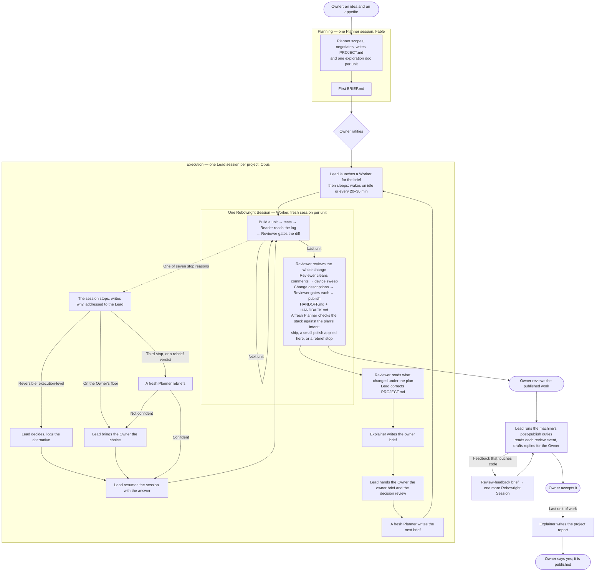

# Robowright, in five minutes

*For people. Agents read `SKILL.md`; the numbers are in `DESIGN.md`; every state machine, drawn, in `STATES.md`. If you are the one running a project, read `OWNERS-GUIDE.md` next: this page is how the system moves, that one is how you move through it, and `../../MANUAL.md` has the commands.*

Robowright lets one engineer ship a whole stack of changes, most of it built by unattended Claude
Code sessions. It is seven roles, a shared folder on disk, and a few rules about who may do what.
The role names are plain job titles, so you can guess what each one does.

> The Planner plans, the Lead leads, the Worker builds, the Reviewer reviews, the
> Reader reads, the Explainer explains, the Owner decides.

## Robowright

Every doc and agent pairs the title with the role at the title's first mention,
"Planner (planner)", so a title never needs decoding, even in a copy of this system that renamed
them.

| Title | Role | Who or what | Does | Never does |
|---|---|---|---|---|
| **Owner** | owner | The human engineer (you) | Picks Robowright's settings at kickoff, approves the plan and each brief's budget, answers the questions only a person should (money, shipping, other people), reads the decision review, reviews, publishes, accepts | — |
| **Planner** | planner | A Claude session on Fable, the most capable and most expensive model tier | Scopes a project, writes the plan and per-unit exploration docs, then writes each **brief**: the contract a Robowright Session executes. Comes back for a **rebrief** when a session has stopped three times, optionally for one **review** of the finished stack against the plan's intent, and for a **replan** when you ask for one | Watch a Robowright Session, write code |
| **Lead** | lead | A Claude session on Opus, one per project | Watches every Robowright Session from disk, decides the reversible execution calls a stop raises and writes each one down with its alternative, brings you only the ones on your floor, folds a finished session back into the plan, asks for the next brief; once the work is published, runs whatever post-publish duties this machine has — where there is a review surface, that means watching the threads and drafting the replies. The only role that talks to you | Write code, write a brief, post a reply, make a decision on your floor |
| **Worker** | builder | A Claude session on Opus (or Sonnet, if the brief says so): one brief, a fresh session per unit | Builds in its own git worktree, with its own device if the project needs one: code, tests, commits, and publishing in whatever form this machine calls published. Runs for hours unattended | Post a comment, accept its own work, ask a question mid-session |
| **Reviewer** | reviewer | A short-lived subagent, Opus for code and Sonnet for prose | Reviews one artifact against its contract and writes findings: a unit's diff, a whole stack, a change description, the comments, a finished Robowright Session's record | See how the work was built, edit anything |
| **Reader** | reader | A tiny Haiku subagent | Reads one big thing and returns one line: a build log's verdict, an element in a UI tree, a Robowright Session's status | Decide anything |
| **Explainer** | explainer | A Claude session on Opus, one per published stack and one per finished project | Writes the **owner brief** you read before you start reviewing (what you must decide, what was decided for you, what changed, at most three places to spot-check) and the **project report** for everyone else at the end | Read the diff itself, decide anything, publish |

## How a project moves

Every hand-off in that picture is a file. `PROJECT.md` is the plan. `BRIEF.md` is the contract.
`run.json` is the machine state. `LEDGER.md` is the append-only log. `HANDOFF.md` is what a cold
reader needs. `HANDBACK.md` is what the plan has to change. No role depends on another role's
conversation, so any session can die and a fresh one picks up from the files.

The seven stop reasons: a decision above the session's authority, a gate that keeps failing, a
behaviour change found inside a refactor, a base branch that moved, a budget hit, a STOP file,
and a finish review that says the stack misses what the plan wanted. Anything else is a logged
assumption and the work keeps going.

A stop goes to the Lead, not to you. Like a manager whose report hit a snag overnight, the Lead
settles what is its to settle, writes down what it chose and what it passed over, and in the
morning brings you your calls plus a review of the rest. The project's **delegation level** (set
once, at kickoff, in `robowright.json`) says how far that goes:

| Level | What reaches you mid-session | What the Planner does |
|---|---|---|
| `owner` | Every stop | Writes briefs |
| `lead` | Only your floor: the budget, more time than the brief allowed, shipping a behaviour change, a schema, public API or protocol change, reversing a settled decision, anything another person reads | Writes briefs, and a **rebrief** you approve when a session has stopped three times |
| `planner` (default) | Only your floor | Rebriefs and relaunches on its own when confident, once per unit of work (a second rebrief comes to you) |

At every level, unless `plan_review` is `off`, a fresh Planner **reviews** the finished stack
against the plan before the session finishes. A small polish it asks for is applied there at
`lead` and `planner`, and comes to you at `owner`.

The Lead can only pick an option a commit on the same branch can undo, must write the decision
and its alternative before the work resumes, and never decides the same session's problems a
fourth time. Everything it decided reaches you once, at intake, as the **decision review**:
ranked by how sure it was, each with what would make it wrong. Overruling one is a brief, not a
message.

**When the work is done, someone still has to own it.** That is the Explainer's job. Before you
read a finished stack you get an owner brief of 1,000 words at most, 400 for a small unit. It
holds what you must decide now, each with the Planner's or the Lead's recommendation; every
decision made on your behalf, ranked by how sure the decider was, with the alternative passed
over; what changed, in one paragraph; at most three places to spot-check, each a line a Reviewer
held or the brief named as a hotspot; and where the detail lives. Nothing to fill in. At the end
of the project the Explainer writes the report for everyone else: a five-minute path for the people who
funded it and a twenty-minute path for the engineers who will maintain it, published only when
you say so.

The same file names a model per role. The defaults are the table above; a small project might
run its Planner on Opus, and a project at `owner` level can run its Lead on Sonnet. Each role
has a floor below which it stops working rather than getting cheaper.

## The rules everyone keeps

- **State lives on disk.** Any session can die and a fresh one continues from the files.
- **One hat per session.** A role change is a new session. A finished unit's context is dead
  weight for the next one, so multi-unit work starts a fresh session per unit.
- **The grader is never the author.** Every check runs in a fresh context that gets the artifact
  and the contract, not the reasoning.
- **Big things go through a Reader.** Logs, UI trees, ledgers: a cheap reader returns the line
  you need. Nobody pastes a build log into their own context.
- **Nobody speaks for the Owner.** Drafts, yes. Anything another person reads: theirs.
- **Only the Lead talks to the Owner.** A Worker's stop is the Lead's to answer or to
  escalate; a Planner's rebrief goes through the Lead; nothing else asks you anything.
- **The budget is a number the Owner ratified**, written in the brief and enforced by whatever
  this machine uses to enforce it. No role raises it.
- **Bring the Owner calls, not summaries.** A report they can only nod at is a failed report.

## Why it looks like this

Most of the cost goes to re-reading each session's own context, not to thinking or writing. So
the design keeps every session small and short, spends the expensive model only where a request
carries judgment (the Planner), and puts cheap readers in front of anything large.

## Where things are

| | |
|---|---|
| This skill | `~/.claude/skills/robowright/` |
| The handbooks | `~/.claude/skills/planner/`, `lead/`, `worker/`, `explainer/` |
| Reviewers and Readers | `~/.claude/agents/reviewer-*.md`, `reader-*.md`, `log-reader.md`, `ui-tree-reader.md` |
| **The machine profile** | `~/.claude/robowright/profile.md` — seven headings holding everything true of *this machine* rather than of the system: how sessions are launched, what a budget is measured in, which tools exist, what only you may do, paths, and the machine's duties at each extension point. Nothing starts without it |
| **A repository's project hook** | `<repo>/.claude/robowright/project.md` — how *that codebase* builds, tests, holds a device, sweeps for regressions, commits, and publishes; its naming; and its duties at each extension point |
| **A Review Overlay** | A file of review enumerations, named by a `reviewer.overlay` duty row in the profile or a hook, that the two code Reviewers apply after their correctness findings. Built or grown with the `review-overlay` skill — mined from review history or chat transcripts, or added one rule at a time; example at `examples/laptop/review-overlay.md`. Optional, and empty until you add one |
| A project | One folder per project — `PROJECT.md`, `DECISIONS.md`, `Agent Explorations/`, `smoke/`, and the owner briefs |
| A project's Robowright settings | `robowright.json` in that folder |
| The project report | `REPORT.md` in that folder |
| A Robowright Session | One directory under the sessions root — `BRIEF.md`, `run.json`, `LEDGER.md`, `HANDOFF.md`, `HANDBACK.md` |
| The roots those last three sit under, the launch command, and the session-name formats | The profile — Paths, Launch; the project hook — Naming |
