# Robowright: states and transitions

<!-- Generated by scripts/session-state.py doc --write from state-machine.json. Edit the table, not this file. -->

Robowright is a set of small state machines that hand work to each other through files. This document draws the whole system first, as the map, then models each machine on its own. It is generated from `state-machine.json`, the same table `scripts/session-state.py` enforces, so a diagram here cannot drift from what the tool allows.

**Two kinds of machine.** Two are *enforced*: the Robowright Session lifecycle and the unit gate loop. Their state is stored in `run.json`, several programs have to agree on it (the launcher, the Stop hook, the roster, every role), and an illegal value costs hours: a session that is both stopped and rotating, a unit closed without a gate verdict. Those fields have one writer, `session-state.py`, and every change is one named event checked against this table. The rest are *documented*: their state lives in handbooks, ledgers and review files, one role walks each of them, and writing them down is what keeps the roles' handbooks consistent.

**Liveness is not a state.** Whether a process is running, quiet, stalled or gone is an observation about this Mac at this minute. It is derived on every tick and never stored, so a laptop that sleeps cannot make `run.json` wrong. The roster verdict below is a classifier over stored state plus that observation.

**It is a statechart, not a flat machine.** The unit loop runs inside `implementing`. The four working states form one composite, because `stop` leaves from any of them and `resume` returns to whichever one it left (recorded as `stop_reason.phase_before`).

**How to read a diagram.** A rounded box is a state; an arrow is an event, labelled with its name. A box around several states means an arrow touching the box applies to every state inside it. Each enforced machine is followed by its transition table: the event, where it is legal, who applies it, the guards checked on disk first, what it writes, and the handbook step it comes from.

## Contents

- [The whole system](#m-system)
- [Robowright Session lifecycle](#m-session) (enforced)
- [Unit gate loop](#m-unit) (enforced)
- [Roster verdict](#m-liveness)
- [Who answers a stop](#m-stop-routing)
- [Rebrief](#m-rebrief)
- [Rotation and compaction](#m-context)
- [The Lead's tick](#m-lead-tick)
- [Intake, after done](#m-intake)
- [Machine-wide locks](#m-device-lock)
- [Publish and accept](#m-publish-accept)
- [Guards](#guards)
- [Illegal stored states](#illegal-stored-states)
- [Stop codes](#stop-codes)
- [Launcher operations](#launcher-operations)
- [Using the tool](#using-the-tool)

<a name="m-system"></a>

## The whole system

One unit of work, from the plan to local main and back to the plan.

- **Stored in:** Nowhere of its own: each state is one of the machines modelled after it
- **Enforcement:** Documented, not enforced: it lives in files and handbooks the tool does not write

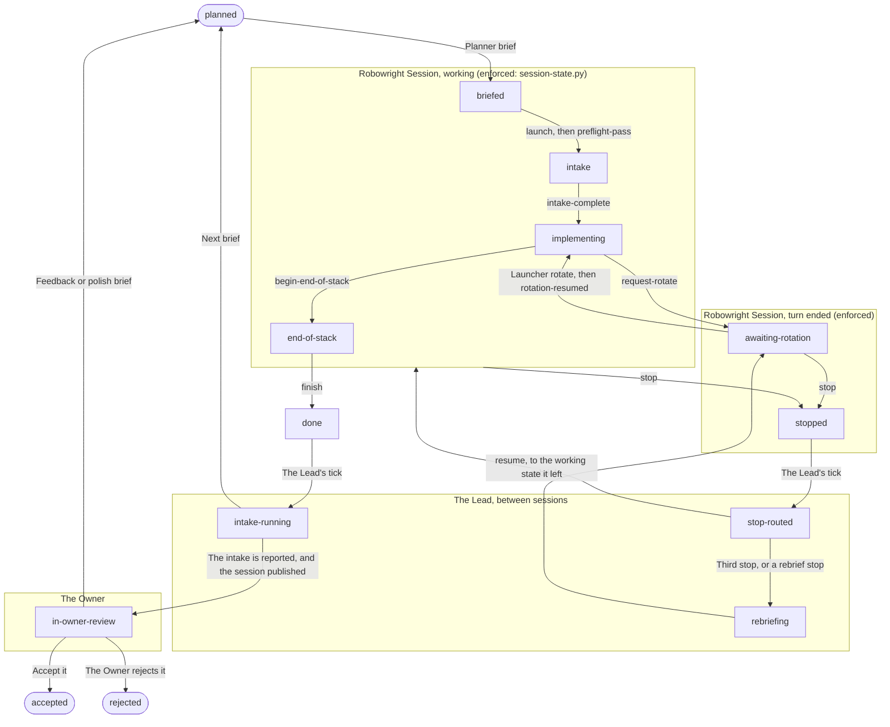

| State | Meaning |
|---|---|
| `planned` (initial) | A row in PROJECT.md's Task Breakdown. The Planner's phases 1-5. |
| `briefed` | Session: briefed. Launch is gated by the budget read and any device lock. |
| `intake` | Session: intake. |
| `implementing` | Session: implementing, with the unit machine inside it. |
| `awaiting-rotation` | Session: awaiting-rotation. See Rotation and compaction. |
| `end-of-stack` | Session: end-of-stack. |
| `stopped` | Session: stopped. |
| `stop-routed` | Who answers a stop. |
| `rebriefing` | Rebrief. |
| `done` | Session: done. |
| `intake-running` | Intake, after done. |
| `in-owner-review` | Publish and accept. |
| `accepted` (terminal) | On local main. The plan's row closes. |
| `rejected` (terminal) | Recorded; the plan's row stays open or is dropped by the Owner. |

| From | On | To |
|---|---|---|
| planned | Planner brief | briefed |
| briefed | launch, then preflight-pass | intake |
| intake | intake-complete | implementing |
| implementing | request-rotate | awaiting-rotation |
| awaiting-rotation | Launcher rotate, then rotation-resumed | implementing |
| implementing | begin-end-of-stack | end-of-stack |
| working, awaiting-rotation | stop | stopped |
| stopped | The Lead's tick | stop-routed |
| stop-routed | resume, to the working state it left | working |
| stop-routed | Third stop, or a rebrief stop | rebriefing |
| rebriefing | rebrief | awaiting-rotation |
| end-of-stack | finish | done |
| done | The Lead's tick | intake-running |
| intake-running | The intake is reported, and the session published | in-owner-review |
| intake-running | Next brief | planned |
| in-owner-review | Feedback or polish brief | planned |
| in-owner-review | Accept it | accepted |
| in-owner-review | The Owner rejects it | rejected |

<a name="m-session"></a>

## Robowright Session lifecycle

One brief run to completion. The only machine whose states a launcher, a hook and a roster all have to agree on.

- **Stored in:** run.json: phase, stop_reason, rotate, rebriefs
- **Enforcement:** `session-state.py` refuses anything not in this table

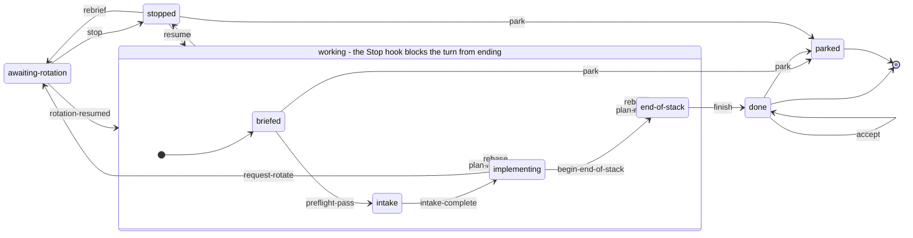

| State | Stored as | Stop gate | Meaning |
|---|---|---|---|
| `briefed` (initial) | `phase = preflight` | block | The Planner wrote BRIEF.md and run.json. Nothing has started, or preflight is still running. |
| `intake` | `phase = intake` | block | Preflight passed. The Worker is verifying the brief's claims and populating units. |
| `implementing` | `phase = implement` | block | The unit loop. Exactly zero or one unit is in flight; the unit machine runs inside this state. |
| `awaiting-rotation` | `rotate.requested_at set, rotate.resumed_at empty; phase keeps the working phase` | release | The session ended its turn on purpose so a fresh one can start. Idle by design: it will not restart itself. |
| `end-of-stack` | `phase = end-of-stack` | block | Every unit is done. Whole-change review, comment pass, smoke, sweep, description, publish. |
| `stopped` | `phase = stopped and stop_reason = {code, detail, at, phase_before}` | release | The stop contract fired. Addressed to the Lead. Resumable: not terminal. |
| `done` (terminal) | `phase = done` | release | Handoff written. The Lead's intake takes over. |
| `parked` (terminal) | `phase = parked and parked = {by, reason, at, from, released}` | release | The Owner said leave it. No event leaves this state. |

| Event | From | To | Who | Guards | Effect | Handbook |
|---|---|---|---|---|---|---|
| `preflight-pass` | briefed | intake | Worker | `brief-exists` | Phase = intake | `worker` Phase 0 step 10 |
| `intake-complete` | intake | implementing | Worker | `units-populated` | Phase = implement | `worker` Phase 1 |
| `request-rotate` | implementing | awaiting-rotation | Worker | `rotation-enabled`, `no-unit-in-flight`, `a-unit-is-done`, `a-unit-is-todo` | rotate = {requested_at, next_unit, resumed_at: null} | `worker` Phase 2 step 9 |
| `rotation-resumed` | awaiting-rotation | working: stored phase | Worker | none | rotate.resumed_at = now | `worker` Phase 0 step 1 |
| `begin-end-of-stack` | implementing | end-of-stack | Worker | `all-units-done` | Phase = end-of-stack | `worker` Phase 3 |
| `plan-review` | implementing, end-of-stack | working: same state | Worker | `plan-review-on`, `plan-review-file-has-verdict` | plan_reviews += {n, at, verdict, unit, path}; the state is unchanged. From implementing it needs --unit (plan_review per-unit) | `worker` Phase 4 finish review; Phase 2 step 8 when per-unit |
| `finish` | end-of-stack | done | Worker | `end-of-stack-review-exists`, `end-of-stack-review-says-advance`, `handoff-exists`, `handback-exists`, `plan-review-settled` | Phase = done | `worker` Phase 4 |
| `stop` | briefed, intake, implementing, awaiting-rotation, end-of-stack | stopped | Worker | `stop-code-known`, `stop-detail-given`, `stop-file-present-for-owner-stop` | stop_reason = {code, detail, at, phase_before}; phase = stopped; a pending rotation is consumed | `worker` rule 2 |
| `resume` | stopped | working: phase before | Lead or Owner | `stop-file-absent`, `decision-given`, `decider-allowed`, `not-rebrief-due-for-lead`, `wall-extension-allowed` | stop_reason = null; phase = phase_before; after a verification-failed stop the unit in flight gets gate_attempts 0, a fresh budget for the decided route; with --wall-hours h, max_wall_hours = h and the event record carries wall_hours [from, h] | `lead` stopped:&lt;code&gt;; applied by whoever decided, before the session is woken |
| `park` | briefed, done, stopped | parked | Owner | `park-is-owner`, `park-reason-given` | Each lock in locks whose owner is this session dir is removed; parked = {by, reason, at, from, released}; stop_reason = null; phase = parked | `OWNERS-GUIDE` Parking a session |
| `accept` | done | done | Owner | `head-given` | accepted = {sha: --head, at}; phase stays done | `lead/scripts/accept.sh`, after main fast-forwards to the squash |
| `rebase` | implementing, end-of-stack | working: same state | Worker | `decision-given`, `decider-allowed`, `base-given`, `head-given` | base_sha = --base; rebases += {n, at, from, to, tip, by, decision}; each --unit-heads pair rewrites that done unit's head; the state is unchanged | `worker` rule 2, after a Lead or Owner decision on record; `lead` base-moved |
| `rebrief` | stopped | awaiting-rotation | Planner | `rebrief-file-has-verdict`, `superseded-brief-kept`, `done-units-untouched` | Every unit that is not done returns to todo with gate_attempts 0 (the Planner may have re-cut them); rebriefs += {n, at, by, verdict, why, stop_code}; stop_reason = null; phase = phase_before; rotate = {requested_at, next_unit, resumed_at: null, reason: rebrief} | `planner` Rebrief session; `lead` stopped, third time |

<a name="m-unit"></a>

## Unit gate loop

One reviewable change. Runs inside the session's implementing state, one unit at a time, in order.

- **Stored in:** run.json: units[i].status, gate_attempts, head, gate.review
- **Enforcement:** `session-state.py` refuses anything not in this table

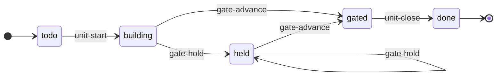

| State | Stored as | Meaning |
|---|---|---|
| `todo` (initial) | `status = todo` | Not started. Every earlier unit must be done first. |
| `building` | `status = building` | Branch, implement, build, scoped tests, kind checks. No gate verdict yet for the current attempt. |
| `held` | `status = held` | The last gate review said HOLD. Triage, one fix commit, re-run, re-gate. At max_gate_attempts the only exit is the session's stop. |
| `gated` | `status = gated` | The last gate review said ADVANCE. Only the close-out remains: whole-suite run if owed, the one run.json write, the ledger entry, HANDOFF.md. |
| `done` (terminal) | `status = done` | Closed. head is recorded. Never revisited. |

| Event | From | To | Who | Guards | Effect | Handbook |
|---|---|---|---|---|---|---|
| `unit-start` | todo | building | Worker | `session-is-implementing`, `predecessors-done` | Status = building | `worker` Phase 2 step 1 |
| `gate-hold` | building, held | held | Worker | `session-is-implementing`, `gate-attempts-under-cap`, `gate-review-is-fresh`, `gate-review-says-hold` | Status = held; gate_attempts += 1; gate.review = path | `worker` Phase 2 steps 6-7 |
| `gate-advance` | building, held | gated | Worker | `session-is-implementing`, `gate-attempts-under-cap`, `gate-review-is-fresh`, `gate-review-says-advance` | Status = gated; gate_attempts += 1; gate.review = path | `worker` Phase 2 step 6 |
| `unit-close` | gated | done | Worker | `session-is-implementing`, `gate-review-says-advance`, `head-given` | Status = done; head = &lt;sha&gt; | `worker` Phase 2 step 8 |

<a name="m-liveness"></a>

## Roster verdict

What the Lead sees. Liveness is an observation about a process, so it is an input to the Lead and never a stored state: a Mac that sleeps must not be able to make run.json wrong.

- **Stored in:** Nothing: derived every tick from run.json, the STOP file and the Claude session registry
- **Enforcement:** Computed by `lead/scripts/run-roster.py`, which takes the stored state and its problems from `session-state.py` and adds liveness

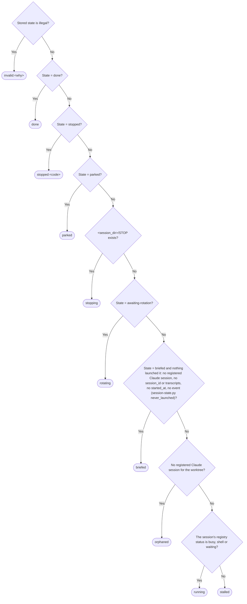

First match wins.

| # | If | Verdict |
|---|---|---|
| 1 | Stored state is illegal | `invalid:<why>` |
| 2 | State = done | `done` |
| 3 | State = stopped | `stopped:<code>` |
| 4 | State = parked | `parked` |
| 5 | &lt;session_dir&gt;/STOP exists | `stopping` |
| 6 | State = awaiting-rotation | `rotating` |
| 7 | State = briefed and nothing launched it: no registered Claude session, no session_id or transcripts, no started_at, no event (session-state.py never_launched) | `briefed` |
| 8 | No registered Claude session for the worktree | `orphaned` |
| 9 | The session's registry status is busy, shell or waiting | `running` |
| 10 | Otherwise | `stalled` |

Flags ride on a verdict and never replace it:

| Flag | When |
|---|---|
| `edited-outside-tool` | A guarded field in run.json no longer matches the newest event in events.jsonl: someone wrote it by hand. The launcher refuses the session until it is put back or adopted |
| `corrupt-event-log` | A line of events.jsonl after the newest event is not an event (a half-written append); adopt re-baselines |
| `no-event-log` | The session is past briefed and has no events.jsonl: it predates the tool, or was written around it |
| `quiet <age>` | Running and updated_at has not moved in two hours |
| `over-wall` | Running, stalled, stopping or rotating past max_wall_hours |
| `over-threshold / over-cap` | Only where the profile's budget is in dollars |
| `dialog` | Running and the registry status is waiting: held on a permission, input or sandbox dialog only the Owner can answer |
| `registry <value>` | Stalled and the registry status is not idle: a status the roster does not know, or none |

<a name="m-stop-routing"></a>

## Who answers a stop

The stop contract from the Lead's side. A stop is never addressed to the Owner directly; the Lead routes it.

- **Stored in:** LEDGER.md and DECISIONS.md entries; the resume transition enforces the hard rows
- **Enforcement:** Documented, not enforced: it lives in files and handbooks the tool does not write

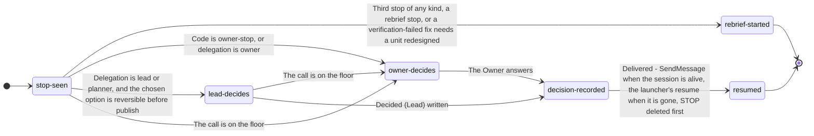

| State | Meaning |
|---|---|
| `stop-seen` (initial) | The roster shows stopped:&lt;code&gt;. The Lead reads stop_reason.detail, the ledger entry and HANDOFF.md open items. |
| `lead-decides` | An execution-level call a commit on the same branch can undo before publish. Recorded before the resume, with the alternative and what would make it wrong. |
| `owner-decides` | Anything on the floor: the budget cap, wall hours past the allowance, a product-visible change, schema or public API, reversing a settled decision, anything another person reads, plus the profile's Owner-only floor. Brought as one message: options, downstream cost, recommendation. |
| `decision-recorded` | A Decided entry in LEDGER.md naming who decided, a DECISIONS.md entry, and the resume event applied with --by and --decision: the session is no longer stopped. |
| `resumed` (terminal) | The Worker is awake in the phase it left and continues from HANDOFF.md FIRST ACTION. |
| `rebrief-started` (terminal) | Handed to the rebrief machine. |

| From | On | To |
|---|---|---|
| stop-seen | Third stop of any kind, a rebrief stop, or a verification-failed fix needs a unit redesigned | rebrief-started |
| stop-seen | Code is owner-stop, or delegation is owner | owner-decides |
| stop-seen | Delegation is lead or planner, and the chosen option is reversible before publish | lead-decides |
| stop-seen, lead-decides | The call is on the floor | owner-decides |
| lead-decides | Decided (Lead) written | decision-recorded |
| owner-decides | The Owner answers | decision-recorded |
| decision-recorded | Delivered: SendMessage when the session is alive, the launcher's resume when it is gone; STOP deleted first | resumed |

<a name="m-rebrief"></a>

## Rebrief

Three stops is a brief problem, not three hard decisions.

- **Stored in:** REBRIEF.md, BRIEF.r&lt;n&gt;.md, run.json.rebriefs; the rebrief transition enforces the file guards
- **Enforcement:** Documented, not enforced: it lives in files and handbooks the tool does not write

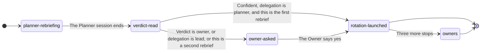

| State | Meaning |
|---|---|
| `planner-rebriefing` (initial) | A fresh Planner reads the plan and, through a Reviewer, the session's record. It rewrites BRIEF.md in place, keeps the old one as BRIEF.r&lt;n&gt;.md, writes REBRIEF.md with a verdict, and applies the rebrief event. |
| `verdict-read` | The Lead reads REBRIEF.md's verdict line only. |
| `owner-asked` | The Owner gets REBRIEF.md's question with the launch line. |
| `rotation-launched` (terminal) | The rebriefed Robowright Session starts as a rotation: it reads the Rebrief section first, then FIRST ACTION. |
| `owners` (terminal) | A rebriefed Robowright Session that stops three more times belongs to the Owner, whatever the level. |

| From | On | To |
|---|---|---|
| planner-rebriefing | The Planner session ends | verdict-read |
| verdict-read | Confident, delegation is planner, and this is the first rebrief | rotation-launched |
| verdict-read | Verdict is owner, or delegation is lead, or this is a second rebrief | owner-asked |
| owner-asked | The Owner says yes | rotation-launched |
| rotation-launched | Three more stops | owners |

<a name="m-context"></a>

## Rotation and compaction

Two ways a Robowright Session sheds context at a unit boundary. Rotation restarts at the fixed context floor; compaction lands above it and is lossy.

- **Stored in:** rotate in run.json for rotation; nothing for compaction, which the harness does on its own
- **Enforcement:** Documented, not enforced: it lives in files and handbooks the tool does not write

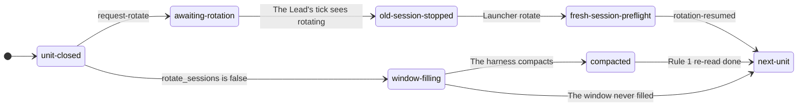

| State | Meaning |
|---|---|
| `unit-closed` (initial) | Everything the unit produced is in files. The context that produced it is dead weight for the next unit. |
| `awaiting-rotation` | rotate_sessions is true: the Worker applied request-rotate and ended the turn; the Stop hook released on that field. |
| `old-session-stopped` | The Lead stopped the previous session the way the profile's Launch section says. Its conversation is kept. |
| `fresh-session-preflight` | The launcher's rotate path started a new session with the same fixed prompt. It runs preflight steps 2-9, then applies rotation-resumed. |
| `next-unit` | Work continues from HANDOFF.md FIRST ACTION. |
| `window-filling` | rotate_sessions is false: the same session continues; the launcher's compaction override keeps the window small. |
| `compacted` | The PreCompact hook told the summarizer what to keep; the SessionStart hook re-injected the session pointer. The Worker re-reads run.json, HANDOFF.md and its non-negotiables before acting. |

| From | On | To |
|---|---|---|
| unit-closed | request-rotate | awaiting-rotation |
| awaiting-rotation | The Lead's tick sees rotating | old-session-stopped |
| old-session-stopped | Launcher rotate | fresh-session-preflight |
| fresh-session-preflight | rotation-resumed | next-unit |
| unit-closed | rotate_sessions is false | window-filling |
| window-filling | The harness compacts | compacted |
| compacted | Rule 1 re-read done | next-unit |
| window-filling | The window never filled | next-unit |

<a name="m-lead-tick"></a>

## The Lead's tick

One pass of the watch. At most one action per Robowright Session per tick.

- **Stored in:** $TMPDIR/roster-state.json between ticks; nothing else, the roster is re-derived from disk every time
- **Enforcement:** Documented, not enforced: it lives in files and handbooks the tool does not write

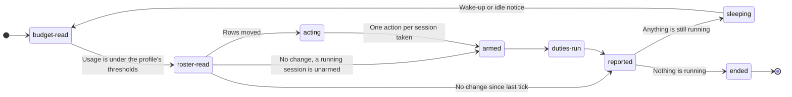

| State | Meaning |
|---|---|
| `budget-read` (initial) | Whatever the profile's Budget section names as the enforcement: started on the first tick, read on every tick and before every launch. |
| `roster-read` | One run-roster.py call with --since and --tail. Only rows that moved print. |
| `acting` | Per verdict: nothing for running, except a dialog flag, reported to the Owner once per appearance with claude attach and never nudged; stop routing for stopped; a registry &lt;value&gt; flag on stalled is a finding for the Owner, never a nudge; otherwise one nudge for stalled, and a second stall after a nudge is a finding for the Owner, never a second nudge; the rotation for rotating; listing it, and nothing else, for briefed; a check of ListAgents, then the resume line, for orphaned; intake for done; for invalid:&lt;why&gt; or a tamper flag, read status and the tail of events.jsonl and bring it to the Owner as a finding. |
| `armed` | notify_when_idle on every running session in registry busy without a live subscription, its status read from one plain run-roster.py call while any is unarmed; none on shell or dialog, since one armed in shell fires at once. |
| `duties-run` | Every duty the profile, then the project hook, lists for lead.tick, in order. |
| `reported` | Decision-reporting shape; a noop when nothing changed. |
| `sleeping` | ScheduleWakeup 1200-1800s while anything is running, 1800-3000s while a stop or a stall is waiting on the Owner; woken early by an idle notice. |
| `ended` (terminal) | Nothing is running and nothing is owed. |

| From | On | To |
|---|---|---|
| budget-read | Usage is under the profile's thresholds | roster-read |
| roster-read | Rows moved | acting |
| roster-read | No change, a running session is unarmed | armed |
| roster-read | No change since last tick | reported |
| acting | One action per session taken | armed |
| armed | Always | duties-run |
| duties-run | Always | reported |
| reported | Anything is still running | sleeping |
| reported | Nothing is running | ended |
| sleeping | Wake-up or idle notice | budget-read |

<a name="m-intake"></a>

## Intake, after done

A finished Robowright Session has moved the ground under the plan. Nothing new is briefed until the plan has caught up.

- **Stored in:** INTAKE.md, PLAN-REVIEW.md, the owner brief, DECISIONS.md, PROJECT.md
- **Enforcement:** Documented, not enforced: it lives in files and handbooks the tool does not write

```mermaid
stateDiagram-v2
    direction LR
    state "session-done" as session_done
    state "plan-reviewed" as plan_reviewed
    state "intake-written" as intake_written
    state "plan-corrected" as plan_corrected
    state "brief-written" as brief_written
    state "reported-to-owner" as reported_to_owner
    state "next-brief-written" as next_brief_written
    state "project-closed" as project_closed
    [*] --> session_done
    session_done --> plan_reviewed : plan_review is not off
    plan_reviewed --> intake_written : Spawn reviewer-intake
    session_done --> intake_written : plan_review is off - spawn reviewer-intake
    intake_written --> plan_corrected : Corrections and Owner asks written
    plan_corrected --> brief_written : owner_brief is on and the session published
    plan_corrected --> reported_to_owner : owner_brief is off
    brief_written --> reported_to_owner
    reported_to_owner --> next_brief_written : Open rows remain
    reported_to_owner --> project_closed : No open rows
    next_brief_written --> [*]
    project_closed --> [*]
```

| State | Meaning |
|---|---|
| `session-done` (initial) | The roster shows done. HANDBACK.md exists. |
| `plan-reviewed` | Unless run.json.plan_review is off: the session's finish review, run through planner-review before finish, left PLAN-REVIEW.md saying ship, or polish that the session applied and gated. A rebrief verdict never reaches done: it stops the session. |
| `intake-written` | Reviewer-intake read the session's record, not the Lead's reasoning, and wrote INTAKE.md in eight sections; lead.intake duties run. |
| `plan-corrected` | PROJECT.md and the exploration docs corrected outside the Resolved Decisions table; DECISIONS.md entry including Rejected; a Lead recommendation appended to PLAN-REVIEW.md (to INTAKE.md when plan_review is off) for every INTAKE.md ask it has none for. |
| `brief-written` | Only when robowright.json.owner_brief is true and the session published: an Explainer wrote the owner brief from the record, never the diff. |
| `reported-to-owner` | Doc-gate on everything that reaches the Owner, then the decision review at the top: every (Lead) and (Planner) decision, ranked by confidence, each with what would make it wrong. |
| `next-brief-written` (terminal) | A fresh, short Planner session wrote the next BRIEF.md and run.json. The Lead never writes a brief. The new Robowright Session is briefed. |
| `project-closed` (terminal) | PROJECT.md's Task Breakdown has no open rows; the Explainer's report, if asked for; the Planner's closing checklist to the Owner. |

| From | On | To |
|---|---|---|
| session-done | plan_review is not off | plan-reviewed |
| plan-reviewed | Spawn reviewer-intake | intake-written |
| session-done | plan_review is off: spawn reviewer-intake | intake-written |
| intake-written | Corrections and Owner asks written | plan-corrected |
| plan-corrected | owner_brief is on and the session published | brief-written |
| plan-corrected | owner_brief is off | reported-to-owner |
| brief-written | Always | reported-to-owner |
| reported-to-owner | Open rows remain | next-brief-written |
| reported-to-owner | No open rows | project-closed |

<a name="m-device-lock"></a>

## Machine-wide locks

One holder per lock name at a time on this machine. The launcher only refuses a second holder of any listed name; the Worker takes and releases.

- **Stored in:** &lt;sessions root&gt;/.&lt;name&gt;-lock/owner; the names are run.json.locks[], each defined by a platform plugin's §6
- **Enforcement:** The launcher refuses to start a second holder of any listed name; taking, releasing and clearing a stale lock are the Worker's, per the project hook; `session-state.py park` removes the parked session's own

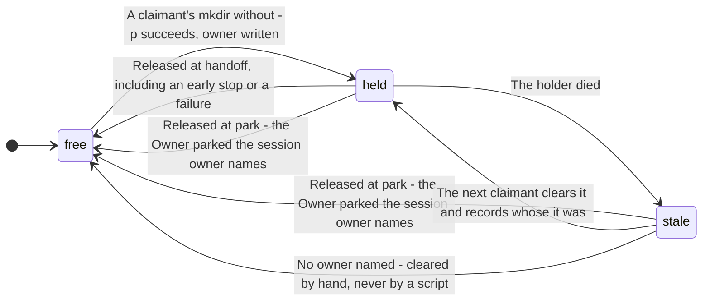

| State | Meaning |
|---|---|
| `free` (initial) | The lock directory does not exist. |
| `held` | The directory exists and owner names a live Robowright Session. |
| `stale` | The directory exists and its owner is not live, or names no owner. The one failure that blocks every later session. |

| From | On | To |
|---|---|---|
| free | A claimant's mkdir without -p succeeds, owner written | held |
| held | Released at handoff, including an early stop or a failure | free |
| held | The holder died | stale |
| held, stale | Released at park: the Owner parked the session owner names | free |
| stale | The next claimant clears it and records whose it was | held |
| stale | No owner named: cleared by hand, never by a script | free |

<a name="m-publish-accept"></a>

## Publish and accept

What published means is the project hook's, named by its publish strategy. Every change is reviewed before the Owner sees it, and only the Owner accepts it into local main.

- **Stored in:** What run.json records that publishing produced; DECISIONS.md for accepted or rejected, per change kind
- **Enforcement:** Documented, not enforced: it lives in files and handbooks the tool does not write

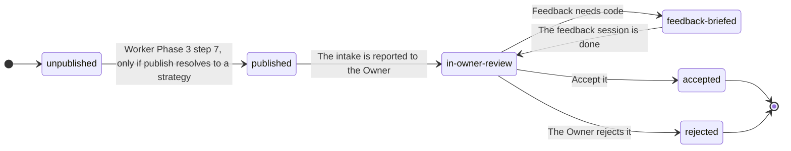

| State | Meaning |
|---|---|
| `unpublished` (initial) | The brief's publish is `false`, or resolves to no strategy, or end-of-stack has not reached step 7. |
| `published` | Exactly what the project hook's Publishing section says and nothing beyond it. |
| `in-owner-review` | The Owner reads the owner brief, then the work. lead.post-publish duties run here. |
| `feedback-briefed` | Feedback that means a code change becomes one Robowright Session per review round, briefed by a Planner. The Lead never commits it. |
| `accepted` (terminal) | The Owner accepted it, and it is integrated into local main. |
| `rejected` (terminal) | Recorded per change kind, so a kind can later earn auto-accept on its measured rejection rate. |

| From | On | To |
|---|---|---|
| unpublished | Worker Phase 3 step 7, only if publish resolves to a strategy | published |
| published | The intake is reported to the Owner | in-owner-review |
| in-owner-review | Feedback needs code | feedback-briefed |
| feedback-briefed | The feedback session is done | in-owner-review |
| in-owner-review | Accept it | accepted |
| in-owner-review | The Owner rejects it | rejected |

## Guards

A guard is a fact the tool checks on disk before it applies an event. A failed guard refuses the event, changes nothing, and is logged.

| Guard | Holds when |
|---|---|
| `brief-exists` | &lt;session_dir&gt;/BRIEF.md exists |
| `units-populated` | run.json.units is non-empty and every unit has an id (a duplicate id or a started unit is already an illegal stored state) |
| `rotation-enabled` | run.json.rotate_sessions is true |
| `no-unit-in-flight` | No unit is building, held or gated |
| `a-unit-is-done` | At least one unit is done: a rotation happens at a unit boundary |
| `a-unit-is-todo` | At least one unit is todo: the last unit goes on to end-of-stack in the same session |
| `all-units-done` | Every unit is done |
| `end-of-stack-review-exists` | &lt;session_dir&gt;/reviews/end-of-stack.md exists |
| `end-of-stack-review-says-advance` | &lt;session_dir&gt;/reviews/end-of-stack.md exists and its verdict is ADVANCE: a HOLD is fixed and re-reviewed, never finished on |
| `handoff-exists` | &lt;session_dir&gt;/HANDOFF.md exists |
| `handback-exists` | &lt;session_dir&gt;/HANDBACK.md exists |
| `plan-review-on` | run.json.plan_review is finish or per-unit (a run.json without the key, or with null, reads as finish); any other value, a non-string included, refuses |
| `plan-review-file-has-verdict` | &lt;session_dir&gt;/PLAN-REVIEW.md exists and its first Verdict: line (backticks and * stripped) says the --verdict word (ship, polish or rebrief); from implementing, --unit names the unit reviewed |
| `plan-review-settled` | run.json.plan_review is off; or the newest finish review (plan_reviews entry with no unit) says ship, or says polish and reviews/polish-gate.md says ADVANCE and is no older than that review. None yet, rebrief, or a plan_review value but finish, per-unit or off (a missing key or null reads as finish) refuses |
| `stop-code-known` | The code is one of stop_codes |
| `stop-detail-given` | --detail is not empty: the Lead reads it before anything else |
| `stop-file-present-for-owner-stop` | owner-stop is only legal while &lt;session_dir&gt;/STOP exists |
| `stop-file-absent` | &lt;session_dir&gt;/STOP is gone, or the Robowright Session stops again at once |
| `decision-given` | --decision is not empty: a resume or rebase with no recorded decision is not a decision |
| `decider-allowed` | --by owner always; --by lead only when run.json.delegation is lead or planner and, for a resume, the stop code is not Owner-only |
| `not-rebrief-due-for-lead` | --by lead is refused on the third stop since the last rebrief: that is a rebrief, or the Owner's call |
| `wall-extension-allowed` | --wall-hours h only on a budget stop, finite and above the stored max_wall_hours; --by lead also at most max_wall_hours × (1 + wall_hours_extension_pct / 100), and only once: an applied lead resume carrying wall_hours uses it up. Without --wall-hours it passes |
| `rebrief-file-has-verdict` | &lt;session_dir&gt;/REBRIEF.md exists and its first Verdict: line (backticks and * stripped) says the --verdict word (confident or owner) |
| `superseded-brief-kept` | &lt;session_dir&gt;/BRIEF.r&lt;n&gt;.md exists for this rebrief number |
| `done-units-untouched` | The done units are exactly the ones the last event recorded, same ids and heads: a rebrief re-cuts only what is not done |
| `session-is-implementing` | The session state is implementing |
| `predecessors-done` | Every unit before this one is done: units run in order, so at most one is ever in flight |
| `gate-attempts-under-cap` | gate_attempts is below max_gate_attempts; at the cap the only exit is stop verification-failed |
| `gate-review-is-fresh` | The gate review file was written after this unit's previous gate event: one review buys one verdict |
| `gate-review-says-hold` | &lt;session_dir&gt;/reviews/&lt;unit&gt;-gate.md exists and its verdict is HOLD |
| `gate-review-says-advance` | &lt;session_dir&gt;/reviews/&lt;unit&gt;-gate.md exists and its verdict is ADVANCE: the grader is never the author |
| `head-given` | --head is a commit SHA (7-40 hex characters) and, when run.json.worktree exists, names a commit there; so is every --unit-heads SHA, each naming a done unit |
| `base-given` | --base is a commit SHA in run.json.worktree and an ancestor of the worktree's HEAD |
| `park-is-owner` | --by owner: parking is the Owner's alone |
| `park-reason-given` | --reason is given and not empty |

Checked on every event, before the transition's own guards (the last one after its effect).

| On every event | Holds when |
|---|---|
| `stored-state-legal` | run.json holds none of the illegal stored states below |
| `log-intact` | The guarded fields still match the newest event in events.jsonl: a hand edit is never laundered by the next legal event. Only adopt re-baselines. (A rebrief ignores the unit rows and the models, which the Planner re-cuts, and checks done-units-untouched instead.) |
| `from-state` | The event is legal from the current state, per the transition table |
| `unit-known` | --unit names a unit run.json has |
| `result-legal` | The state the event would write is itself legal; otherwise nothing is written |

## Illegal stored states

Combinations run.json can hold and the machine cannot produce. The tool refuses every event while one holds, a launcher refuses the session, and the roster prints invalid:<name>.

| Name | Holds when |
|---|---|
| `unknown-phase` | Phase is not one of the seven the table knows |
| `stopped-without-code` | Phase is stopped and stop_reason has no code: a stop nobody can route |
| `unknown-stop-code` | stop_reason.code is not one of the stop codes |
| `done-and-stopped` | Phase is done and stop_reason is set |
| `parked-and-stopped` | Phase is parked and stop_reason is set: park always clears it |
| `done-and-rotating` | Phase is done and a rotation is pending |
| `stopped-and-rotating` | stop_reason is set and a rotation is pending: the Stop hook, the launcher and the Lead would each read it differently |
| `bad-publish` | Publish is not one of the four publish strategies, false, null, or the record publishing wrote |
| `unknown-unit-status` | A unit's status is not todo, building, held, gated or done |
| `duplicate-unit-id` | Two units share an id |
| `two-units-in-flight` | More than one unit is building, held or gated |
| `unit-out-of-order` | A unit is done after one that is not |
| `bad-gate-attempts` | A unit's gate_attempts is not a whole number |
| `gate-attempts-over-cap` | A unit's gate_attempts exceeds max_gate_attempts |
| `units-started-before-implement` | A unit has left todo while the session is in preflight or intake |
| `units-open-after-implement` | A unit is not done while the session is in end-of-stack or done |
| `implementing-without-units` | Phase is implement and there are no units |
| `rotating-mid-unit` | A rotation is pending while a unit is in flight |

## Stop codes

| Code | Meaning |
|---|---|
| `one-way-door` | A decision the brief's authority section puts above the Worker |
| `verification-failed` | A unit's gate failed max_gate_attempts times, or the end-of-stack review held max_gate_attempts times, or no device and no fallback |
| `behavior-change` | A product-visible behavior change found inside a refactor or coverage unit |
| `base-moved` | Base SHA is no longer an ancestor, or another session touched the worktree |
| `budget` | max_wall_hours exceeded, or the profile's budget gate tripped |
| `owner-stop` | &lt;session_dir&gt;/STOP exists |
| `rebrief` | The finish review said the stack does not do what the plan says; never resumed, a rebrief Planner answers it |

The Lead may decide a stop only at `delegation: lead` or `delegation: planner`, never for `owner-stop`, and not on stop 3 since the last rebrief.

## Launcher operations

What a launcher may do to a Robowright Session, by stored state. `session-state.py check-op` answers these. A stopped session is not resumable until its decision is recorded: whoever decided applies the resume event first, then the session is woken or relaunched.

| Operation | Legal from |
|---|---|
| `launch` | briefed, intake |
| `rotate` | awaiting-rotation |
| `resume` | briefed, intake, implementing, end-of-stack |

## Using the tool

```
session-state.py <session_dir> status            what state is this, what may happen next
session-state.py <session_dir> <event> [options] apply one transition, or be refused with the rule
session-state.py <session_dir> check             exit 1 when the stored state is illegal or was edited by hand
session-state.py <session_dir> check-op <op>     what the launcher asks before launch, rotate or resume
session-state.py <session_dir> adopt --by owner --reason <text>   baseline a session the tool did not write
session-state.py doc --write                     regenerate this file
```

Every applied event appends one line to `<session_dir>/events.jsonl`: the event, who, from, to, its arguments, and a digest of the guarded fields. Every refusal is appended too, with the guard that failed, because an agent asking for an illegal transition is a signal the Lead should see. `check` compares the digest of the newest applied event with `run.json` as it is now, so a guarded field edited by hand shows up as `edited-outside-tool` and the roster prints `invalid`.

`run.json` keeps its shape. The tool adds two keys inside `stop_reason` (`at`, `phase_before`), three unit statuses between `todo` and `done` (`building`, `held`, `gated`), the `parked` phase with its `parked` record, and nothing else, so a reader written before it still reads every file it writes. A stop code beside a working phase, which older sessions wrote, is read as `stopped` and never written.

To change the machine: edit `state-machine.json`, give any new guard or event its function in `session-state.py` (the tool refuses to run while the two disagree), run `scripts/test_session_state.py`, then `session-state.py doc --write`.
